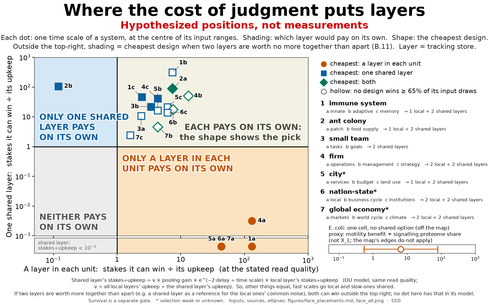

# A Theory of Adaptive Organization

*Chad Mitchell ([@torusflow](https://x.com/torusflow)). Public working draft, CC0. Not peer reviewed; the new math is not yet independently reviewed.*

The theory on one page: [`CORE.md`](CORE.md). The predictive keystone is scoped there (§4): it is numerically supported only in Model S, given convexity, which remains unproved; a rhythm is a two-state mode by degree, but a pair-count does not recover the cheapest design.

Anything that must stay alive in a changing world has to act before the world arrives, and that judgment has a price: memory to hold, errors and lateness to absorb, information to buy and share. **The claim is that one cost sets how adaptive systems should be built at every scale: in layers matched to the time scales of the world, as many as the stakes can pay for and faster looking cannot replace.** Matched is not equal: a rhythm is a two-state mode by degree (that convention is not a shortcut that recovers the cheapest design; CORE §4), and at the full optimum (one layer per separated scale, L2), with each store's own noise small next to the sensing noise, each layer runs faster than the scale it tracks, by a factor the sensing noise sets (7–15× in the worked case), never past the next scale; a store whose own noise dominates can be slower than its scale (Model S+, `theory/STORE_NOISE.md`). Faster looking can stand in for a layer (reads substitute for layers, CT33), so stakes buy more layers only where looking faster does not do the job. Physics enters only as a floor under the prices.

**The law of adaptive organization (hypothesis): strongly selected systems minimize the cost of judgment.**

$$
\min_{\mathcal D}\; \kappa\, I_{\text{mem}} + h\,K \;+\; w\,\mathbb E[\ell_{\mathcal D}] \;+\; A(\mathcal D) + L(\mathcal D) \quad \text{subject to}\quad P(\text{ruin}) \le \varepsilon_r
$$

Choose the design (layers, what each tracks, how it senses, what it shares) that makes holding memory, being wrong or late, and acquiring and sharing information cheapest without going broke. The world is a measured input.

**What follows** (proved in a model; the layer results are linear-Gaussian):
- One real time scale needs one layer (or none, when stakes are small), even a self-similar random walk; J separated real time scales need J layers once stakes outweigh upkeep, each layer faster than its scale (by a factor the sensing noise sets) when a store's own noise is small next to the sensing noise; a store whose own noise dominates is faster than its scale when that noise's exponent s > 1/2 (at s = 1/2, λτ\* = 1 at low signal-to-noise, equal, not faster), and at low signal-to-noise only then (λτ\* = (1 − s)/s; E. coli's s = 0.31 gives about 2.2, slower; known from the ten Wolde line of work, incl. Tjalma & ten Wolde 2024; `theory/STORE_NOISE.md`); a rhythm is a two-state mode by degree, but that is not a pair-count rule for K* (CORE §4).
- With sensing fixed and ruin not binding, layers never fall as stakes rise relative to upkeep. With reads chosen they can (reads substitute for layers); what never falls is total judgment spend, **provided the ruin constraint is slack at the stakes compared or absent** (a two-line proof; when ruin binds, spend can fall and error rise: counterexample in `scope_checks.py` §1b).
- A shared layer forms once enough members face a common driver; cheap lookup dissolves layers that only hold facts.
- Lateness caps how far one tracker reaches, so systems whose reports arrive late federate.
- Survival is free above a buffer and decides the design below it. The buffer a unit needs grows as shock × τ^H, with H = ½ (√time to fix) for a random-walk error, so faster correction raises the shock it survives.
- For a tracker with negligible read noise of a power-law world, the optimum spends α − 1 on looking for every 1 it loses to being wrong, in any currency (it fails with read noise or when the world has its own time scale, and when a ruin constraint binds the shares and price elasticities differ). In a system's own units the equation is the same problem at every scale, though not with the same numbers.

- Whether to centralize is an output of the same cost: a shared level pays above a group size, lateness caps its reach, and merging pays when the gain over competing exceeds the cost of linking (a definition of the comparison, not a theorem); free-riding parties capture only about half the pooling gain (proved in a toy). Shared-driver coupling is a potential game: sequential best response converges, and damped simultaneous response converges only below a step of 2/N for N equal parties (above it, it oscillates). No general convergence theorem is true; whether separating the parties' speeds helps inside the theory's class, and which real couplings are potential games, are open.



*Where the cost of judgment puts layers* (`figures/face.png`; v2.5.3, revised after independent map reviews 26 (NOT READY, then READY-WITH-FIXES) and 28 (READY-WITH-FIXES, fixes confirmed READY by the same reviewer)). Each time scale of a system's world is a point: stakes a layer in each unit can win ÷ its upkeep (across) and stakes one shared layer can win ÷ its upkeep (up), at the stated read quality. Shading shows which single layer pays on its own; each marker's shape is the cheapest design. Outside the top-right the two agree, with edges at 1, exactly when the layers are worth no more together than apart (THEORY B.11). When a shared store pays as a reference for the local ones, both can win below the edges. Fast scales go local and slow ones shared. A layer is a tracking store, not an org-chart level. The dots are hypothesized positions from stated guesses; E. coli is a proxy shown beside the map. See `figures/face_placements.md`.

**How it dies.** "Strongly selected" is defined operationally and preregistered: a cost-to-fitness map, a population proxy (cities, nations and the biosphere are excluded until one exists), a band that selection can resolve and that excludes a named rival, and a defined redesign time with at least 10 of them in the same world. For each substrate class, fix before measuring a closed list of cost terms, the world's spectrum and noise, and the prices. Misses in qualifying systems, outside the preregistered band around the minimum, refute the hypothesis for that class once they exceed a binomial allowance fixed in advance from the class's preregistered coverage and minimum number of systems (for a small class, one miss); misses in two classes at different scales refute it across scales; a needed cost not on the list is a miss, and so is a design that does not move with a measured change in its inputs, unless the post-change gap is inside the redesign band at the lower bound of the class's preregistered redesign cost (CT41, `theory/DYNAMICS.md` §2). A band exists only where adjustment is lumpy, and only if the class preregisters, before data, the redesign cost on the closed term list (point estimate and error budget, measured independently of the design), the curvature w, the input-process type (step or drift) and T or σ_d. A gap between the bands at the cost's lower and upper bounds is INDETERMINATE. If the band at the upper bound covers the predicted move, the move test is NOT A TEST. Without these preregistered quantities the band is zero and the rule is unchanged. How a real system's layers are counted (distinct measured memory time constants, by degree) is the draft method in [`measurement/LAYER_COUNT_RULE.md`](measurement/LAYER_COUNT_RULE.md); a class must still preregister that method before a test (THEORY §3). Re-measuring is allowed once, before the comparison. The bet is untested, not refuted. Field results are first gated on qualification under the pre-written definition, then reported as passed or failed on proxy. No field claim so far had a recorded pre-test qualification check, so those results are not tests of the hypothesis (status: NOT A TEST, with the proxy result kept in the label). The parts are known and credited; the claim is new. Open: what happens when a system and the world it reshapes co-adapt as coupled levels.

**[`THEORY.md`](THEORY.md) is the one canonical statement of the theory (v2.9 draft, 20 November 2026, America/New_York; v2.5.x, v2.7, v2.8 and v2.9 are deltas on v2.4; v2.8 is the ht-index work, merged).** Claim statuses: `measurement/CLAIM_MAP_v2.md` (v2.78). Where the work stands: [`STATUS.md`](STATUS.md). What is still open: [`OPEN_WORK.md`](OPEN_WORK.md).

```
THEORY.md         The theory, v2.9 draft (start here; §5 the theorem, §7 uses, §8 tests)
theory/           Derivations and code checks (MASTER_EQUATION.md, LAYERS.md)
measurement/      Validity gates and one status per claim
tests/, reviews/  Preregistered tests and reviews
reference/        Earlier versions and the changelog
```

AI agents helped draft, compute and review these files under the author's direction. License: [CC0 1.0](LICENSE.md).
