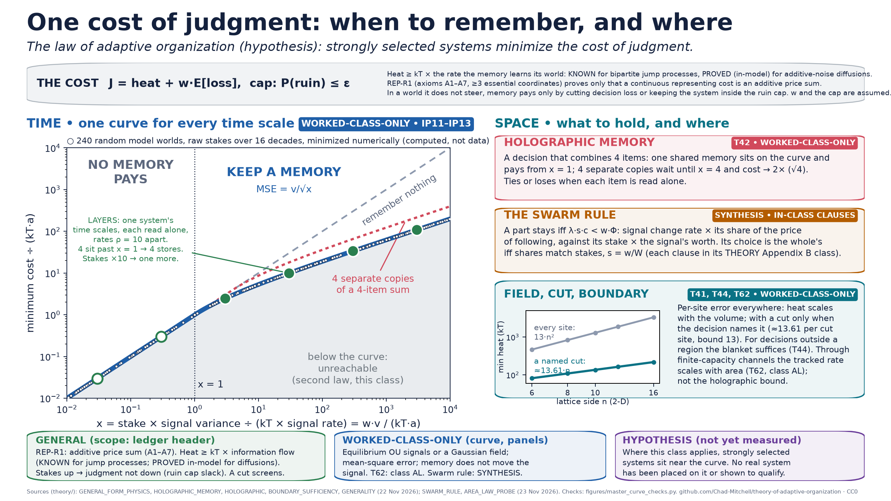

# A Theory of Adaptive Organization

*Chad Mitchell ([@torusflow](https://x.com/torusflow)). Public working draft, CC0. Not peer reviewed.*

Thermodynamics tells an engineer two things about any engine: the best it could possibly do, and how far a real one falls short. This theory aims to do the same for adaptive systems: cells, colonies, brains, teams, firms, AI and robot systems, anything that must act before its world arrives. Its object is the cost of judgment: being wrong or late plus the cost of holding, acquiring, and sharing information, under a cap on the chance of ruin. In the proved physical class, the memory term is bath heat—at least \(kT\) times the rate at which the memory learns, for bipartite chains and additive-noise diffusions—plus the stake on error (a separate display from `THEORY.md`'s five-term sum, open work T40). In worked classes the minimum is computed, in closed form where the class allows, and it says what the best design looks like: how many layers, what to share, where a boundary is enough, when a shock should strengthen a system rather than harm it. If the hypothesis below holds, any adaptive system can be measured against its minimum, and the gap says where it wastes and what would close it.

**The law of adaptive organization (hypothesis): strongly selected systems minimize the cost of judgment.**

Some of the mathematics holds in general: a representation theorem for systems meeting axioms A1–A7, and five further results that need no Gaussian or linear step. Each design result (layers, holographic sharing, boundaries, rebuilding, acting) is proved in a worked model. That they come from one minimum, and that strongly selected systems sit near it, is the hypothesis. The one-page statement is [`CORE.md`](CORE.md).

**First evidence.** In simulations of the authors' own worlds, selection converged to the predicted minimum in clean worlds: the positive control, W1 and W2 of EVO1 (`tests/EVO1/RESULTS_EVO.md`), SIM-1 (T28 P1–P4 passed in-model, including the high-β Moran arm P4), the high-β mode of the selection bridge (T27 P1; its low-β prediction P3 failed, so T27 failed overall), and LEARNSIM's regime-A level-class prediction (CLAIM_MAP G26; overall T1.8 row G25 is SIM-INCONCLUSIVE). Where the world added an obstacle, selection stalled or the run was invalid—a creation valley (EVO1 W4, 3/8), a ruin gate (W3, INVALID), and store noise (two INCONCLUSIVE arms)—while several locked in-model predictions failed substantively: every EVO1 W4b seed stopped at the no-sharing rival (8/8), and ANTS1 (nonlinear readout breaking \(\sqrt{N}\) pooling), SENSING2 (G9), and LAYERS1 (G20) have locked SIM-FAIL rows (`measurement/CLAIM_MAP_v2.md`). Real-data attempts so far did not qualify under THEORY §3: every scored field result is NOT A TEST (30 rows: 10 passed on proxy, 20 failed on proxy) or INCONCLUSIVE (7 rows). The real-system test is next: qualify a strongly selected system, preregister and hash-lock the prediction, and measure whether its design sits at the minimum.



*One cost of judgment, in time and in space* (`figures/master_curve.png`, from `figures/master_curve.py`; every claim and its source is in `figures/master_curve.md`). In the worked class every time scale lands on one curve in the stake ratio \(x=wv/(kT\,a)\): below \(x=1\) no memory pays, above it a memory pays and its error falls as \(v/\sqrt{x}\). The space panels are holographic memory (T42) and the field and boundary results (T41, T44). Where real systems sit on the curve is the hypothesis. The earlier derivation map is `figures/derivation_map.png`.

## What holds in general

These hold without a Gaussian or linear step. The first is a theorem about any system that meets the representation axioms A1–A7 (`theory/REPRESENTATION.md`). The others hold under the conditions stated with each (`theory/GENERALITY_2026-11-22.md`).

1. **The cost is a priced sum.** For any system that meets A1–A7, on at least three essential interval coordinates, a continuous cost that represents its preferences is an additive price sum, up to one positive scale and one additive constant, and its memory coordinate is finite-law Shannon information (Theorem R1; a differential mutual information of a Gaussian plant is the extension A6 already names). R1 does not choose the coordinate list (A6 fixes only which information is the memory coordinate), so it does not derive the five terms of THEORY §3. Nonnegative prices are a further assumption, A8, and the integer layer count \(hK\) needs an extra separability assumption.
2. **Memory costs heat.** A bipartite memory's bath gives off at least \(kT\) times the information flow of its own transitions, for bipartite chains and for additive-noise diffusions.
3. **Higher stakes buy more judgment.** On a menu that does not depend on the stake, for a cost \(S+wE\) with ruin slack or absent, judgment spend does not fall as the stake rises, and the error does not rise.
4. **A boundary can be enough.** A joint law that factorizes across a cut screens the two sides. The expected loss is a function of the blanket posterior when the loss depends on the world only through the exterior and the decision is a function of the screened side.
5. **Convex payoffs gain from shocks, and caps can reverse it.** An uncapped convex payoff has expectation at least the payoff of the mean; a cap can reverse that comparison.

6. **Zero-gain control drops out.** If the control enters the generator only as an additive drift \(b\,u\), and the martingale problem for the uncontrolled generator is unique, the process at \(b=0\) is the uncontrolled process.

The closed forms below (the holographic-memory factor, the turnover rate, the gains) are worked examples in clean classes.

## The cost

In the class where the learning rate has been worked out, the cost of judgment is the heat of the memory's bath plus a stake on the decision loss. The chance of ruin is a cap beside the sum.

$$J = \dot Q + w\,\mathbb{E}[\ell] \qquad\text{subject to}\qquad P(\text{ruin})\le\varepsilon.$$

THEORY §3 still prints a different sum. \(\kappa\) is the price of one nat of memory \(I_{\mathrm{mem}}\), \(h\) is the upkeep of one layer, \(K\) is the number of layers, \(A\) is the price of reading the world, and \(L\) is the price of linking:

$$\kappa I_{\mathrm{mem}} + hK + w\,\mathbb{E}[\ell] + A + L.$$

The sum is a different object, and IP5, the claim that it is the physical frontier, is false (CLAIM_MAP section Y). The bath heat replaces \(\kappa I_{\mathrm{mem}}\). The floor on the heat is \(kT\) times the learning rate (Horowitz and Esposito 2014, doi 10.1103/PhysRevX.4.031015, checked on Crossref 22 November 2026). \(hK\) sits outside that floor. \(w\,\mathbb{E}[\ell]\) survives, and temperature does not set the stake \(w\). A continuous sensor's read is already inside the heat. A separate read price \(A\) stays assumed. The link price \(L\) stays assumed and stays outside the heat-plus-stake sum. The ruin cap stays assumed and stays beside the sum.

[`THEORY.md`](THEORY.md) is the one canonical statement of the theory (v2.9 draft). Where this page and that file disagree, that file governs. Adopting the physics display into §3 is open work, T40, proposed in `theory/GENERAL_FORM_PHYSICS_2026-11-22.md` §9.

The worked class is an exogenous equilibrium Ornstein–Uhlenbeck signal, independent signals of that kind, or the two-state telegraph. The memory does not move the signal. The loss is a mean square, or Hamming error on the telegraph. Inside that class the theory computes the heat floor in closed form, and for the Ornstein–Uhlenbeck signals it computes the minimizing design in closed form (for independent heterogeneous modes under sum loss, up to one scalar multiplier equation). The floor on one OU signal is \(kT\,a(v-\varepsilon)/\varepsilon\), approached in a limit; the minimizing cost above the blind stake is \(2\sqrt{kT\,a\,v\,w}-kT\,a\); a geometric ladder tracks \(\lfloor\log(wv/(kT a))/\log\rho\rfloor+1\) modes, with no free constant per layer; a sum of modes is carried by one rank-one memory; the telegraph heat approaches \(kT\) times its information flow.

## Five yields of one minimum

Each yield below is proved in the class named with it. That the five are one minimum of one cost is the synthesis the hypothesis asserts (`theory/ACTING_LOOP_2026-11-22.md` §8).

**Layers, along time.** When each mode is scored on its own, one real time scale needs one store, or none when the stake is small. On the geometric ladder the count is the formula above. When the loss is the error in the sum, one rank-one memory carries the modes. The older placement view, [`figures/face.png`](figures/face.png), marks for each time scale local, shared, both, or neither. Spacing those stores under a closed loop is unsolved.

**Holographic memory.** In the storage sense (many items held in one shared state), a shared memory costs less when the decision combines many items—\(K\) separate memories of \(K\) identical modes cost \(K\) times the heat at the same error—while it ties or costs more when every item is read on its own, and a random code is not optimal when the decision is known (`theory/HOLOGRAPHIC_MEMORY_2026-11-22.md`). In the field sense, the heat floor for per-site bulk error scales with the volume, and scales with a cut only when the decision names that cut (`theory/HOLOGRAPHIC_2026-11-22.md`). Holographic memory is not a separate assumption: the one cost predicts when it wins.

**Boundary.** For a decision outside a region of an equilibrium Gaussian field, the conditional law given the region and the Markov blanket equals the law given the blanket. The interior is not sufficient for that decision. The matching blanket channel costs at most the Schur trace more than the channel it matches (`theory/BOUNDARY_SUFFICIENCY_2026-11-22.md`).

**Rebuild, and gaining from shocks.** Under the ruin cap, replacement of identical capacity-limited units can lower the long-run cost: rate 1 costs 15.473978 with ruin probability 0.020940, against an inadmissible zero-shock point at cost 16 (`theory/antifragility_checks/RESULTS.md`). The heterogeneous arm's grid minimum stays at no shock. That comparison is a puzzle at this cap. Heat is proportional to precision, and the admissible grid kept the more precise units. Gaining from shocks is convexity in the shock (Taleb and Douady 2013, doi 10.1080/14697688.2013.800219, checked on Crossref 22 November 2026; `theory/ROBUSTNESS.md` already uses that reading). The cost turns it into a design question: when is the gain worth buying, and with what. A second worked answer is a probe that makes the minimized cost fall as volatility rises; the drop is the price of a fraction falling as \(1/\theta\) (`theory/ACTING_MEMORY_2026-11-22.md`). No theorem here makes replacement and probing one object.

**Acting.** With the channel unpriced, closed-loop regulation is cheaper than sensing alone by \((q-2aP(a))\theta\). At unit stake, unit drift, and unit variance that gap is \(0.171572875254\), against a sensing-alone cost of \(1\). With the heat and the probe charged, the gap is negative at every fraction at stake \(1\). At stake \(4\) the gap at the minimizing fraction is \(0.033889928154\). Feedback shrinks the information stock and leaves the learning-rate heat fixed (`theory/ACTING_LOOP_2026-11-22.md`). When the action enters the drift, the additive form is a representation theorem, R1′; that feedback heat selects a smaller gain is a conjecture on the cubic plant (merged as [PR #203](https://github.com/Chad-Mitchell/theory-of-adaptive-organization/pull/203), OPEN_WORK T47, not adopted into `THEORY.md`).

## Where this is going

1. **The cost is universal:** \(J_{\mathrm{phys}} = \dot Q + w\,\mathbb{E}[\ell]\), subject to \(P(\mathrm{ruin})\le\varepsilon\), is defined for any adaptive system (`THEORY.md` §3 still prints the five-term sum; adopting \(J_{\mathrm{phys}}\) there is open work T40).
2. **The method is general:** write the cost, find its minimum, and read off the design. No single closed-form design exists for every system (not even in thermodynamics); each class has its own exact answer.
3. **The floor spreads class by class:** it is proved now for bipartite chains and additive-noise diffusions (`theory/GENERALITY_2026-11-22.md`, `theory/GENERAL_FORM_PHYSICS_2026-11-22.md`). Next in order are T48 (general continuous mutual information), T49 (non-Gaussian closed forms), and the open Kalman–Bucy minimum-power factor-of-2 question (Sandberg, Delvenne, Newton & Mitter 2014, doi 10.1109/allerton.2014.7028503, checked on Crossref; open, not settled). The goal is a floor for every adaptive system.
4. **The evolutionary design method (where no closed form exists):** a search scored by \(J\) (selection or an evolutionary algorithm) reaches the minimum with predicted excess \(\mathbb{E}[J]-J^*=d/(2\beta)\) near a quadratic minimum (`core/bridge_2026-11-21/BRIDGE.md`, `core/bridge_2026-11-21/SELECTION.md`, `theory/SELECTION_AXIOMS.md`, `theory/DRIFT_SELECTION.md`) only under three checks a designer must verify, each with an in-repo counterexample when violated: (i) **strong selection** (T27 P1's high-\(\beta\) mode held while its low-\(\beta\) prediction P3 failed, `core/bridge_2026-11-21/RESULTS.md`), (ii) **a reachable minimum with no uncrossable valley** (EVO1 W1/W2 and SIM-1 converged in clean worlds, but EVO1 W4 stalled behind a creation valley 3/8 and every W4b seed stopped at the no-sharing rival 8/8, `tests/EVO1/RESULTS_EVO.md`, `core/sim1_2026-11-21/`), and (iii) **a cost that includes the relevant terms** (EVO1's store-noise arms were INCONCLUSIVE on the cost band, `tests/EVO1/RESULTS_EVO.md`). No guarantee holds outside those conditions.
5. **Antifragility:** gaining from shocks is convexity; the cost says when that gain is worth buying, with one worked example in `theory/ACTING_MEMORY_2026-11-22.md`.
6. **The real-world test:** qualify, preregister, and measure.

## What remains

Math first, then the real-world test (`OPEN_WORK.md` §3):

1. **The A6 extension in continuous form (T48, next proof).** Mutual information as the limit of discrete partitions (Gelfand–Yaglom–Dobrushin), expected to carry the discrete results over unchanged.
2. **Non-Gaussian closed forms (T49).** Heavy tails, switching, rare shocks, other losses, and a memory that moves its world: sharper numbers for the test, not a change to the theory.
3. **The decisive test.** Qualify one real strongly selected system before measuring it, preregister and hash-lock the prediction, and measure whether its design sits near the minimum.
4. **Open items and puzzles.** Adopting the physics display (T40) and the acting derivation (T47) into `THEORY.md`; the fractal draft, [PR #192](https://github.com/Chad-Mitchell/theory-of-adaptive-organization/pull/192), from which this page uses no result; and two puzzles from the boundary and acting-memory preregistrations, the integer \(5\%\) radius and \(J^*(8)\) against 5, each with its next test written (`CORE.md` §6).

## How a miss is read

"Strongly selected" is the definition in [THEORY §3](THEORY.md). No system has been shown to qualify. Before measuring, a class fixes a cost-to-fitness map, a population proxy, a band that excludes a named rival, and a redesign time with at least ten of those times in the same world. Cities, nation-states, global economies, and the biosphere wait for a proxy. A design outside the band fixed in advance is a puzzle for that class. The diagnosis and the next test are written down beforehand. A field result with no recorded qualification check is not a test of the hypothesis. No real system has been shown at the minimum ([`STATUS.md`](STATUS.md)). Counting layers is the draft method in [`measurement/LAYER_COUNT_RULE.md`](measurement/LAYER_COUNT_RULE.md).

## Where to read

Claim statuses: `measurement/CLAIM_MAP_v2.md` (v2.88). Where the work stands: [`STATUS.md`](STATUS.md). What is still open: [`OPEN_WORK.md`](OPEN_WORK.md). The previous front page and the previous one-pager are `history/2026-11-22_README_before_front.md` and `history/2026-11-22_CORE_before_front.md`.

```
THEORY.md         The theory, v2.9 draft (canonical statement; §3 is still the five-term cost)
CORE.md           The same argument on one page
theory/           The heat, the five yields, and the checks
measurement/      One status per claim
figures/          master_curve.png, the master picture; derivation_map.png and face.png, earlier views
```

AI agents helped draft, compute, and review these files under the author's direction. License: [CC0 1.0](LICENSE.md).
