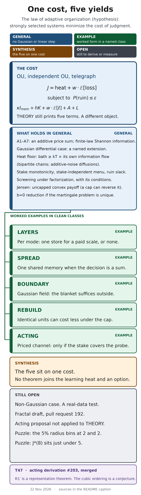

# A Theory of Adaptive Organization

*Chad Mitchell ([@torusflow](https://x.com/torusflow)). Public working draft, CC0. Not peer reviewed.*

**The law of adaptive organization (hypothesis): strongly selected systems minimize the cost of judgment.**

Until a qualifying system is measured, read that sentence as a principle: one cost of judgment, and the design is what the cost selects. The heat floor and its minimizers are proved in one class: an exogenous equilibrium Ornstein–Uhlenbeck signal, independent signals of that kind, or the two-state telegraph; a mean-square loss, or Hamming error on the telegraph; a memory that does not move the signal. The telegraph is in that class. Other Gaussian systems stay open, and other linear systems stay open, including a memory that moves its world. No system has been shown to qualify, so nothing on this page is a test from a real system. The one-page statement is [`CORE.md`](CORE.md).



*One cost, five yields* (`figures/derivation_map.png`, from `figures/derivation_map.py`). The cost is at the top. **GENERAL** results hold without a Gaussian or linear step. The five rows are worked examples in named classes. The join of the five is a synthesis. **OPEN** is not derived, or not yet measured.

## The cost

In the class where the learning rate has been worked out, the cost of judgment is the heat of the memory's bath plus a stake on the decision loss. The chance of ruin is a cap beside the sum.

$$J = \dot Q + w\,\mathbb{E}[\ell] \qquad\text{subject to}\qquad P(\text{ruin})\le\varepsilon.$$

THEORY §3 still prints a different sum. \(\kappa\) is the price of one nat of memory \(I_{\mathrm{mem}}\), \(h\) is the upkeep of one layer, \(K\) is the number of layers, \(A\) is the price of reading the world, and \(L\) is the price of linking:

$$\kappa I_{\mathrm{mem}} + hK + w\,\mathbb{E}[\ell] + A + L.$$

The sum is a different object. The bath heat replaces \(\kappa I_{\mathrm{mem}}\). The floor on the heat is \(kT\) times the learning rate (Horowitz and Esposito 2014, doi 10.1103/PhysRevX.4.031015, checked on Crossref 22 November 2026). \(hK\) sits outside that floor. \(w\,\mathbb{E}[\ell]\) survives, and temperature does not set the stake \(w\). A continuous sensor's read is already inside the heat. A separate read price \(A\) stays assumed. The link price \(L\) stays assumed and stays outside the heat-plus-stake sum. The ruin cap stays assumed and stays beside the sum.

[`THEORY.md`](THEORY.md) is the one canonical statement of the theory (v2.9 draft). Where this page and that file disagree, that file governs. Adopting the physics display into §3 is open work, T40, proposed in `theory/GENERAL_FORM_PHYSICS_2026-11-22.md` §9.

The worked class is an exogenous equilibrium Ornstein–Uhlenbeck signal, independent signals of that kind, or the two-state telegraph. The memory does not move the signal. The loss is a mean square, or Hamming error on the telegraph. Inside that class the floor on one OU signal is \(kT\,a(v-\varepsilon)/\varepsilon\), approached in a limit; the minimizing cost above the blind stake is \(2\sqrt{kT\,a\,v\,w}-kT\,a\); a geometric ladder tracks \(\lfloor\log(wv/(kT a))/\log\rho\rfloor+1\) modes, with no free constant per layer; a sum of modes is carried by one rank-one memory; the telegraph heat approaches \(kT\) times its information flow.

## What holds in general

For any system that meets A1–A7, on at least three essential interval coordinates, a continuous cost that represents the preorder is an additive price sum, up to one positive scale and one additive constant. The memory coordinate in that sum is finite-law Shannon information, in the scope of A6. A differential mutual information of a Gaussian plant is the extension A6 already names.

A bipartite memory's bath is bounded below by \(kT\) times the information flow of its own transitions, for bipartite chains and for additive-noise diffusions. On a menu that does not depend on the stake, for a cost \(S+wE\) with ruin slack or absent, judgment spend does not fall as the stake rises, and the error does not rise. A joint law that factorizes across a cut screens the two sides; the expected loss is a function of the blanket posterior only when the loss depends on the world through the exterior and the decision is a function of the screened side. An uncapped convex payoff has expectation at least the payoff of the mean; a cap can reverse that comparison. If the control enters the generator only as an additive drift \(b\,u\), and the martingale problem for the uncontrolled generator is unique, the process at \(b=0\) is the uncontrolled process.

The closed forms (the memory-spread factor, the turnover rate, and the gains) are worked examples in clean classes. Whether real systems sit near the minimum is the open hypothesis.

## Five yields of one minimum

Each line below is proved in the class named with it. The sentence that the five are one minimum is a synthesis. `theory/ACTING_LOOP_2026-11-22.md` §8 states that limit.

**Layers, along time.** When each mode is scored on its own, one real time scale needs one store, or none when the stake is small. On the geometric ladder the count is the formula above. When the loss is the error in the sum, one rank-one memory carries the modes. [`figures/face.png`](figures/face.png) is the placement: for each time scale, local, shared, both, or neither. Spacing those stores under a closed loop is unsolved.

**Spread, across items.** One memory carries a sum. \(K\) separate memories of \(K\) identical modes cost \(K\) times the heat at the same error. A shared memory costs less when the decision is a combination of items, and it ties or costs more when every item is read on its own (`theory/HOLOGRAPHIC_MEMORY_2026-11-22.md`). The heat floor on a per-site error scales with the volume. Holding a named cut scales with the cut (`theory/HOLOGRAPHIC_2026-11-22.md`). The name "holographic" adds no prediction those equations do not already make.

**Boundary.** For a decision outside a region of an equilibrium Gaussian field, the conditional law given the region and the Markov blanket equals the law given the blanket. The interior is not sufficient for that decision. The matching blanket channel costs at most the Schur trace more than the channel it matches (`theory/BOUNDARY_SUFFICIENCY_2026-11-22.md`).

**Rebuild.** Under the ruin cap, replacement of identical capacity-limited units can lower the long-run cost: rate 1 costs 15.473978 with ruin probability 0.020940, against an inadmissible zero-shock point at cost 16 (`theory/antifragility_checks/RESULTS.md`). The heterogeneous arm's grid minimum stays at no shock. That comparison is a puzzle at this cap. Heat is proportional to precision, and the admissible grid kept the more precise units.

**Acting.** With the channel unpriced, closed-loop regulation is cheaper than sensing alone by \((q-2aP(a))\theta\). At unit stake, unit drift, and unit variance that gap is \(0.171572875254\), against a sensing-alone cost of \(1\). With the heat and the probe charged, the gap is negative at every fraction at stake \(1\). At stake \(4\) the gap at the minimizing fraction is \(0.033889928154\). Feedback shrinks the information stock and leaves the learning-rate heat fixed (`theory/ACTING_LOOP_2026-11-22.md`). A probe can make the minimized cost fall as volatility rises. The drop is the price of a fraction falling as \(1/\theta\) (`theory/ACTING_MEMORY_2026-11-22.md`).

## Options, and the learning heat

A payoff convex in a shock gains from a spread of that shock. Antifragility is that convexity. Optionality is a convex payoff bought with a capped premium. Both are standard mathematics (Taleb and Douady 2013, doi 10.1080/14697688.2013.800219, checked on Crossref 22 November 2026), and `theory/ROBUSTNESS.md` already uses that reading. A search of this repository finds the two routes written side by side in the acting-memory note, and finds no theorem that makes them one object. The synthesis is that the learning heat and the option sit under this one cost. That sentence is the hypothesis in another shape. It is not a proof.

## Acting derivation

The acting derivation is merged ([PR #203](https://github.com/Chad-Mitchell/theory-of-adaptive-organization/pull/203); OPEN_WORK T47). Theorem R1′ is a representation theorem, and the cubic ordering is a conjecture. The proposal is not applied, and `THEORY.md` is unchanged.

## What remains

- The non-Gaussian case, and a loss other than the mean square or the telegraph mismatch. A memory that changes the world it tracks.
- A real-data test: a system qualified before the measurement, then scored against the cost. No such test is on this page.
- The fractal draft, [PR #192](https://github.com/Chad-Mitchell/theory-of-adaptive-organization/pull/192). This page uses no result from it.
- Adopting the acting derivation into `THEORY.md` (T47 is merged; the proposal is not applied). The master equation is unchanged.
- The integer \(5\%\) radius. It is 2 at both \(\tau=1/2\) and \(\tau=1\), ratio 1, because both crossings of the level 0.05 fall in the bin \((1,2)\). A longer path, the next test the preregistration named, returned 2 and 2. The smooth crossing is a separate statistic, ratio 2.067863694520, inside \([1.7,2.3]\).
- \(J^*(8)\) against 5. The grid value is 4.998066177768. The number 5 is the heat plus the sign loss at the frozen fraction, above a floor of 4.966383544211. The crossing is near \(\theta=7.5267\). The next test is a new preregistration scored against that floor.

## How a miss is read

"Strongly selected" is the definition in [THEORY §3](THEORY.md). No system has been shown to qualify. Before measuring, a class fixes a cost-to-fitness map, a population proxy, a band that excludes a named rival, and a redesign time with at least ten of those times in the same world. Cities, nation-states, global economies, and the biosphere wait for a proxy. A design outside the band fixed in advance is a puzzle for that class. The diagnosis and the next test are written down beforehand. A field result with no recorded qualification check is not a test of the hypothesis. Counting layers is the draft method in [`measurement/LAYER_COUNT_RULE.md`](measurement/LAYER_COUNT_RULE.md).

## Where to read

Claim statuses: `measurement/CLAIM_MAP_v2.md` (v2.88). Where the work stands: [`STATUS.md`](STATUS.md). What is still open: [`OPEN_WORK.md`](OPEN_WORK.md). The previous front page and the previous one-pager are `history/2026-11-22_README_before_front.md` and `history/2026-11-22_CORE_before_front.md`.

```
THEORY.md         The theory, v2.9 draft (canonical statement; §3 is still the five-term cost)
CORE.md           The same argument on one page
theory/           The heat, the five yields, and the checks
measurement/      One status per claim
figures/          derivation_map.png, the one cost; face.png, the layer placement
```

AI agents helped draft, compute, and review these files under the author's direction. License: [CC0 1.0](LICENSE.md).
