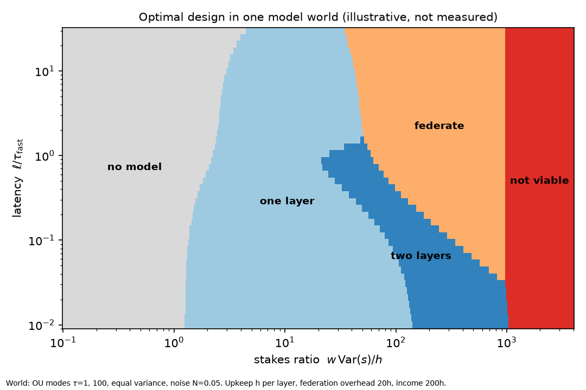

# A Theory of Adaptive Organization: the cost of judgment — v2.4 draft (20 November 2026)

Author: Chad Mitchell (X: [@torusflow](https://x.com/torusflow)). Public domain (CC0). Not peer reviewed. v2.3 was independently reviewed once (verdict NOT READY: four statements of scope too wide); v2.4 restates those, and the restatements and the new results (CT30–CT34) have not been reviewed. **This file is the one canonical statement of the theory; where anything else in the repository disagrees, this file governs.** The main text (§1–§10) reads in about 15 minutes. Appendix A fixes the model and notation, Appendix B proves every numbered result, and Appendix C maps each result to its claim row and its derivation. Claim statuses: `measurement/CLAIM_MAP_v2.md` (v2.53). The previous core is frozen at `reference/THEORY_v2.0.md`; the changelog and the full record of tests and reviews are in `reference/` and the folders it indexes.

**Status words.** *Proved in-model*: a theorem inside the stated model, which says nothing by itself about nature. *Known*: a published result, credited. *Open*: untested, not refuted. *Passed/failed on proxy*: a locked prediction scored on an instrument that fails at least one validity gate, which is a result about that instrument, not about the theory.

## 1. Judgment and its cost

Everything runs down. The second law lets order last only where something pays to keep it, exporting disorder as it goes. An atom or a crystal pays almost nothing: nothing it does changes whether it lasts, so a model of the world would buy it nothing. A star or a flame pays a steady flow of energy and regulates itself, but anticipates nothing. Cells, colonies, people, firms and cities are different. They must stay far from equilibrium in a world that keeps changing and can ruin them, and they cannot wait for that world to arrive. Once acting late is costly, it pays to carry a model and act ahead.

That is **judgment**, and judgment has one cost: holding memory, being wrong or late, and buying and sharing the information that keeps memory fresh, all without going broke. The theory adds no physics to the second law. Physics enters only as a floor under the prices (§3), which above the cell is slack; the theory prices what staying alive takes, and says the price sets the design: where the world changes on several time scales, build in layers, one for each time scale the stakes can pay for. The same cost decides when a model should be shared, who must be in charge, and how far one tracker can reach.

The bet is that strongly selected systems (defined operationally in §3), at every scale, sit near that cost's minimum. It dies the first time such a system, with its world and its costs measured before the comparison, puts its design somewhere else or needs a cost not on its preregistered list (§8).

## 2. The claim

**The claim is that one cost sets how adaptive systems should be built at every scale: in layers, one for each separated time scale of the world that the stakes can pay for, each tuned to its scale and the sensing noise.**

*Tuned* means what the theory proves and no more. The count follows the world: a layer for each separated time scale the stakes can afford. The timing does not copy the world: each layer's memory is set by its own mode **and** the sensing noise, and every layer runs faster than its mode (the filter's poles interlace the world's, L2): a 90-day mode gets a store of 6–12 days in one worked case, so layers are *tuned to* the time scales, not *at* them. *Physics* supplies the reason upkeep exists and a floor under every price (kT per nat, §3); above the cell those floors are slack (§9), so the claim above is a claim about economics of judgment, not about thermodynamics, and the second law does no further work in it.

## 3. The master equation

A system that must act ahead of a world it does not control chooses its design 𝒟 to

$$
\min_{\mathcal D}\; J(\mathcal D) \;=\; \underbrace{\kappa\, I_{\text{mem}} + h\,K}_{\text{holding memory}} \;+\; \underbrace{w\,\mathbb E[\ell_{\mathcal D}]}_{\text{being wrong or late}} \;+\; \underbrace{A(\mathcal D) + L(\mathcal D)}_{\text{acquiring and sharing information}} \qquad \text{subject to}\quad P(\text{ruin}) \le \varepsilon_r .
$$

- **𝒟**, the design: the number of layers K, what each tracks, how and how often it senses, and what it shares.
- **κ·I_mem + h·K**: the price κ per nat held per unit time, and the upkeep h of each layer, store or shared level.
- **w·E[ℓ]**: the stake times the expected loss at the moment of use. Lateness counts as error, because a prediction that arrives after the moment to act buys nothing.
- **A(𝒟)**: information-acquisition spend, priced per read (Σ c_k f_k, read price times read rate), per nat acquired (λ), or per unit of precision (c′·r^{−θ}).
- **L(𝒟)**: link, telling and lookup costs: κ_b per member–level link, d per member told, u per lookup at use rate μ. This is what puts pooling and sharing inside J.
- **Ruin**: a reserve that starts at buffer B, earns income y and pays J hits zero; ε_r is the tolerated chance.
- **The world** is exogenous and enters only through its measured pattern of change: its spectrum or Markov kernel, the sensing noise N and the lead k at which actions meet it. The drift level q and spectral slope α are the scale-free special case.
- **One currency per system** (heat, attention, money, compute). Physics sets floors on the prices (at least kT per nat acquired or erased by a measuring tracker, and kT·(I_mem − I_pred) for memory that does not predict: Landauer 1961, Still et al. 2012), not exchange rates between systems. In each system's own units the equation is the same problem at every scale: only dimensionless ratios matter, and the optimal cost shares are currency-free (CT24); the distance from the floor is one measured number per system.
- **Open lever.** Effort g spent making the world drift less (homeostasis, buffers, contracts) belongs in the problem, but it makes the world depend on the design, so every theorem below holds the world fixed, g = 0; the coupled case is the open theorem of §9 (CX2, CL11).

The equation is assembled from known parts; the repository already wrote it as Axiom 5 of `reviews/night1/formal/AXIOMS.md`. It is the theory's statement of the problem, not a theorem.

**The law of adaptive organization (hypothesis): strongly selected systems minimize the cost of judgment.**

Here *minimize* means: sit within a preregistered band of the minimum of J, given the system's measured world. This is a bet, untested and not yet earned.

**Strongly selected (operational; preregister before measuring anything).** A system class is strongly selected when (a) a rival design whose cost J is lower by a fraction δ, where δ is the preregistered measurement-error band of J, would displace the incumbent within the observation record, given the class's measured turnover (replication, entry and exit, or retraining), that is, s·N_e ≥ 10 for s the fitness gain of a δ cut in J (the drift-barrier condition, Lynch et al. 2016); and (b) the lineage has faced the same world for at least 10 of its own redesign times (N54). A class that does not qualify is not evidence either way. Drift-limited misses below the barrier are therefore excluded by construction and cannot be invoked afterwards.

**What would kill it.** Fixed before the test, per substrate class (cells, firms, cities, …): (1) a closed list of J's cost terms, the world's drift spectrum and noise, and the prices, each measured independently of the design they predict, with the measurement protocol and error budget (`measurement/FRAMEWORK.md`, "Preregistered kill conditions"); (2) the design's predicted optimum with its error band. Then **one preregistered miss** in a qualifying system, meaning the layers (count, memories, read rates) fall outside the band around argmin J, refutes the hypothesis *for that substrate class*; **misses in two classes at different scales** refute it as a cross-scale hypothesis; a needed cost that is not on the preregistered list counts as a miss unless it was added publicly before the test. Re-measuring the world is allowed once, before the comparison, never after it. To count as *support* the minimum must also beat a named rival (a fixed budget share; a universal exponent of ½). Until then, what is established is a principle (§4), theorems proved in-model (§5), and field results passed or failed on proxy.

*One picture.* The best design in one made-up model world (two time scales; `theory/meq_checks/phase.py`), on dimensionless axes, stakes over upkeep (w·Var/h) and latency over the fast time scale (ℓ/τ_fast), so any system is a point. With sensing fixed the regions run no model → one layer → two layers as stakes rise, and federation at high latency; the "not viable" region at the top is an artifact of holding the income fixed at y = 200h while stakes rise, and a two-scale world caps the layers at two by construction. Do not read either as a property of J. The dotted contours are the share of the optimal cost spent on upkeep (CT24: ∂ ln J\*/∂ ln h); they are a reparametrization of the x-axis within each region, and they become measurable once stakes are (GAPS G3). The corrected map, with a many-scale world, read effort optimized, no ceiling in R, federation as a latency-driven alternative, and **hypothesized** placements from a bacterium to the biosphere, is `figures/face.png` (derivation and caveats: `figures/face_placements.md`): regions computed from J, positions guesses.

## 4. What kind of theory this is

The theory has three parts. A **definition**: the cost J. A **principle**: strongly selected, persistent adaptive systems sit near the design that minimizes J, to within the tolerance ε their selection can resolve. That has the form of a variational principle, as least action does, with one difference that matters: least action has no free prices and J does, so the principle says something only through structure that holds for every price (§5 (ii)–(iii)) and through prices measured independently of the design they predict. Whether real systems obey it is untested, not refuted. If strongly selected systems across scales are found near the cost's minimum, that cross-system regularity would earn the hypothesis of §3 its name in the scientific sense; until then what is established is a principle. **Theorems**: what minimizing J implies, proved in stated classes (§5).

The world's pattern of change is a **measured input**, not part of the theory, so there are two kinds of wrong. **A wrong picture of the world** means re-measuring and getting a new design; it costs little, because regret is second order in the picture error (CT23: misjudging drift 2× costs about 4–6%), except near cliffs such as the viability edge or the lookup cliff, where a small error can flip survival. **A wrong or missing cost kills the theory**: no regret bound covers a cost J cannot book.

## 5. The theorem

**Master Theorem** (proved in-model in the linear-Gaussian class 𝓜_LG, Appendix B.9: exogenous Gaussian world, stationary or with stationary increments, sensed through white noise or read exactly; layers are first-order stores with rates in a compact set; squared error at lead k; ruin imposed through the Lundberg bound. Parts (ii) and (iii) were restated in v2.4 after the independent review of v2.3 found them too wide; the restatements are not yet reviewed.)

- **(i) Existence** (CT20). If any design survives, a best design exists, and its layer count is at most J(𝒟₁)/h for any surviving one-layer design 𝒟₁.
- **(ii) Monotone comparative statics** (CT20, CT33). *With sensing fixed* (reads not chosen), the best layer count never falls as stakes rise relative to upkeep (w/h), in any world and for any loss, and a single layer's best read rate never falls as w/c rises. *With read rates chosen*, the layer count **can** fall as stakes rise, because reads substitute for layers (a counterexample is in B.9, and the many-scale map's federation boundary is another case); what stays true in every design class is that **total judgment spend** (upkeep plus sensing, J\* − w·E\*) never falls and the error never rises as w rises at fixed prices (CT33). Scoped this way (ii) is a robust, price-free prediction: more at stake means no less is spent on judgment.
- **(iii) The world caps the layers, counted by degree** (CT21). The best layer count is at most the number of dimensions of the world's optimal predictor (its McMillan degree), where a layer is one state. A world with one real time scale (an OU mode, a random walk) needs one layer, **including the self-similar random walk** (L1): K\* ∈ {0, 1}, never more (K\* = 0, acting blind, can win when stakes are small). A world with J separated real time scales needs at most J, exactly J (at zero lead) once R = w·E_∞/h is large enough, and layers beat one flat tracker iff R > R\* = min_K (K−1)/(Δ₁ − Δ_K), with Δ_K the relative excess error of K layers (L2). Every layer is faster than its mode (the filter's poles interlace the world's). **A rhythm is a two-state mode:** a lightly damped oscillation needs two layers by degree, and real first-order stores approximate it only with a count that keeps growing as stakes rise (excess error 68%, 45%, 39% for 1, 2, 3 stores in the worked case). A continuum of time scales has no exact finite design (L3).
- **(iv) The price of survival.** Below a minimum buffer B_min no design survives. Above B_slack the ruin constraint is slack and the expected-cost rules are exactly optimal. In between it binds with a multiplier μ_s > 0, the price of survival, which moves the design from the expected-cost optimum (μ_s = 0) toward Theorem L's survival-optimal design (the μ_s → ∞ end) (CT22). In the diffusive-reset class the constraint is the temperature: per-window ruin ≤ ε_r means z = B/(σ√τ) ≥ z_ε, so the buffer needed grows as shock × √(time to fix). The square root is the Brownian case: where the error since the last fix is self-similar with exponent H (fractional Brownian motion; H = 1/α_s for a stable-law world of index α_s), the group is z = B/(σ·τ^H), the buffer needed is z_ε·σ·τ^H, and the largest survivable shock falls as τ^{−H}, so faster correction raises the ceiling (CT25, proved in a model: exact by self-similarity, checked on simulated fBm; first passage is Black & Cox 1976, not Merton's terminal default). The spread's time growth is all this shares with Drăgulescu & Yakovenko's (2000) money-gas "temperature": an analogy only. That stress *strengthens* a system is not implied; it needs an adaptation rule and stops at B_min (K7, open).
- **(v) Special cases.** Each named result is J under a stated restriction, and `theory/meq_checks/meq_derive.py` checks each derivation:

| Result | J restricted to | Gives |
|---|---|---|
| Read-rate rule (CT12, CT13) | one layer, exact reset reads, A = c/T | J(T) = c/T + w·q·T^{α−1}/α: read rate ∝ (w·q/c)^{1/α}; a 2× input error costs ≈ 6% at α = 2 |
| First bit must pay (CT4; Theorem P, CT1–CT3) | κ·I_mem + w·E only | carry a model iff κ < 2 ln 2·a²·Var (Gaussian); size grows with log stakes; when acting blind is not viable a model is necessary |
| Layers (L1–L3, CT21) | J_K = h·K + w·E_K, sensing fixed by noise N | (iii) above |
| Sharing (Result 4: B2, CT16, B12) | L = telling or link cost, pooled stakes | a shared level pays iff N > N\*(ρ) = (√(1+ρ)+1)²/ρ; telling pays iff d/c < 1/N\* − 1/N; with per-read broadcast, never unless ρ > 4t/(1−t)², t = c_b/c |
| Freeze, hold or look up (T8, CT11) | L = μ·u | a fact is frozen, held or looked up by its drift; the band widens N² when shared |
| One clock for many (CT17) | several parts, one A | one clock costs more unless c_i/(w_i·σ_i²) is equal |
| Reach (LAT-1, CT19) | E at latency ℓ = L/v | error ≥ q·ℓ^{α−1}, so L_max = v·(D\*/q)^{1/(α−1)} |
| Survival (CT22; Theorem L, CL2) | the ruin constraint | (iv) above |
| Physics floor (CT7) | A priced at λ ≥ kT per nat | J\* ≥ σ√(2kT·w): **a floor on J, not a solution of it** |

**Theorem L, stated correctly.** Theorem L maximizes the survival exponent. Its best interval does not depend on the buffer, and it reduces to the expected-cost rule when the reserve's own noise dominates, not when the buffer is large. The large-buffer statement is (iv).

**Scale-free cost shares (CT24, proved).** For any design problem whose cost is a price-weighted sum of price-free terms **and whose feasible set does not depend on the prices** (no ruin constraint, or one that is slack), J\* is homogeneous of degree 1 in the prices, so by the envelope and Euler theorems (the duality of Hotelling 1932 and Shephard's lemma) each term's share of the optimal cost equals the elasticity of J\* in its price, and the shares sum to 1. **A binding ruin constraint breaks this**: its feasible set depends on the prices (the reserve pays J) and on income and buffer, which are not prices of J's terms, so Euler runs over all of them and elasticities exceed shares (in the worked case 0.584 and 0.563, summing to 1.147, against shares 0.528 and 0.472; slack, all 0.500). A share is currency-free and measured twice, as a spend ratio and as a price response, an over-identified test. For one tracker (CT12) with exact (noise-free) reads of a self-similar (power-law) world, the sensing share is (α−1)/α and the share lost to being wrong is 1/α: **looking costs α − 1 for every 1 lost to being wrong, in any currency, at any scale** (α = 2 is the classical equal costs of the order-quantity rule, Harris 1913). It does not hold with read noise (for a random walk read through noise the ratio falls from 1 to 0.89, 0.62, 0.50 as the noise grows) or for a world with a time scale of its own (one OU mode: 0.99 down to 0.58 as c/w rises), so any test must first measure that read noise is negligible. Independent trackers each obey it with their own α; for coupled layers the split is not derived (conjecture). It is a cross-scale prediction (N57, open) for trackers with negligible read noise: α from the measured drift spectrum, the ratio from spend and measured loss, the elasticity from an exogenous price shift (a cell's cost of sensing, a firm's cost of monitoring); three readings of one number must agree. It needs the cost of error in the same currency, so it inherits the measurement gap G3. The same homogeneity makes w, h and c a system's shadow prices when it allocates a binding budget: the multiplier of a read budget is 1/w, and a K-way allocation gives K − 1 testable equalities of marginal value (KKT, convex single-tracker class); that observed allocations satisfy these K − 1 equalities is the testable statement (CX5; the identity itself, that multipliers are shadow prices, is a definition, so the content is that real systems allocate optimally). With the floor priced at β·kT per nat, J\* rises by β^{(α−1)/α} and the shares do not move: the gap to the floor changes the size of a system's cost, not the shape of its trade-off.

## 6. The spine

1. Judgment has one total cost, holding memory plus being wrong or late plus acquiring and sharing information, with the risk of ruin as a constraint, and physics puts a price floor under each part at every scale.
2. The theory is that cost and the design that minimizes it; how the world changes is an input, measured on each system, never assumed.
3. A world that changes on one time scale is tracked best by one layer (or none, when the stakes are small), even when that change is a self-similar random walk.
4. A world with several separated time scales is tracked best by one layer per scale once the stakes outweigh a layer's upkeep (R > R\*), each layer's memory set by its scale and the sensing noise and faster than the scale it tracks; with sensing fixed the count keeps rising with stakes over upkeep, and with a continuum of scales it has no finite end; with reads chosen it is total judgment spend that rises.
5. The architecture inherits the world's scale structure: where change is scale-free the layers come out roughly log-spaced (exactly geometric for shared clocks, CL12), and where it has rhythms (days, quarters, seasons) there is one two-state (resonant) layer per rhythm, counted by degree, in the linear-Gaussian class (deterministic seasonality is not a stationary Gaussian mode at all).
6. Across members the same cost decides when to centralize: a shared level forms once enough members face a common driver and telling is cheap, cheap lookup dissolves levels that only hold facts, lateness caps a level's reach so that beyond L_max a system federates, and a part that bears only some of the whole's loss under-watches, so expect someone in charge (below).
7. A wrong picture of the world costs second-order regret and is fixed by re-measuring before the test, but the theory dies, for a substrate class, at one preregistered miss in a strongly selected system, with inputs measured independently of the design, or if some level needs a cost not on that class's preregistered list.

**When to centralize: the equation decides.** Whether a system is run from the middle or from its parts is an output of J, not an assumption: one comparison, a shared tracker's cost (upkeep, telling, lateness) against each member tracking alone. These results assume the parts cooperate; whether self-interested parts reach them is CX2 (§9).
- *Pooling.* A shared level beats separate trackers once N > N\*(ρ) members face a common driver (CT14), and telling pays iff d/c < 1/N\* − 1/N (CT16).
- *Dissolving.* Cheap lookup removes levels that only hold facts (CT11).
- *Reach.* A central tracker holds a tolerable error only within L_max, beyond which a system federates unless a shortcut raises v (CT19).
- *Authority.* A part that bears only Λ_i of the whole's loss reads at (Λ_i/Λ_whole)^{1/α} of the right rate, so the part under-reads (CT17); that an enforcer or shared fate follows, unless shared upkeep is privately rewarded, is an interpretation, not part of what CT17 proves. Pooling, dissolving, reach and authority are proved in a model.
- *Coupling.* Federation pays iff Σᵢ Jᵢ\* + J_coupling < J\* of one flat tracker: that is a definition of the comparison, not a theorem (CX3). It becomes a conjecture only once J_coupling's functional form is specified and the boundary it predicts is stated (open). The question has a direct literature: Coase (1937) and Williamson on when to organize; team theory (Marschak & Radner 1972); hierarchies and polyarchies (Sah & Stiglitz); the organization of knowledge (Garicano 2000).

**Ants and the trail (CT30; proved in a model).** Ants are the decentralized limit: where every signal is cheap and local, a trail deposited as a by-product of use, no central tracker pays. In the model class (a random walk seen through noise, quadratic loss) the steady-state optimal tracker is exponential smoothing, x ← (1−λ)x + λ·signal, which is exactly *reinforce by use* (a deposit λ per use) plus *evaporate at rate λ*, with λ\* = (−ρ + √(ρ² + 4ρ))/2 for ρ = q/r, which is √(q/r) per unit time: the evaporation rate is set by drift over noise (and by q, w, c′ and θ together when precision is priced, CT15's form; the loss weight w drops out at fixed noise). When trails drift independently, local updates that use only their own signal equal the centralized Kalman filter exactly (checked to 10⁻¹⁴), so no central tracker pays; a shared driver is what a pooled level (CT14) buys. It fails when use is endogenous: if choice follows the trail, the trail measures choice share × relevance and can lock onto the worse path (checked: 19 of 20 runs). **Proved in a model:** this update rule is optimal and decentralizable. **Still a hypothesis:** that real ants and synapses implement it because selection favored it. Dorigo, Maniezzo & Colorni (1996) build the same update into ant-colony optimization and Deneubourg et al. (1990) model Argentine-ant recruitment; the Lasius niger trail lifetime (about 47 minutes, Beckers, Deneubourg & Goss 1993) is measured but has never been compared with q/r. The one nonlinear ant-like readout simulated failed (Lemma B7).

**Two axes, one rule.** Stores lie across time scales and levels across members, from one comparison of a layer's saving with its upkeep. Levels copy the world's shared-drift structure, one per shared driver whose pooled stakes pay (CL13, CL14), as stores copy its time scales. In a nested tree, levels fill from the broadest scope down iff shared drift falls slowly enough with scope (χ < χ\* = (1−a)/(1−b), formal Theorem 7; CL15). That the architecture inherits the world's scale structure is T7 (CL16).

**Pooling and nesting (CT28, CT34; proved in a model, with conditions).** Two exact results and one conjecture. *(1) Homogeneity of the single-tracker cost under pooling* (upkeep-free power class): in the power-class model J\*(nW) = n^{1/α}·J\*(W), so pooling n members costs n^{a−1} of n separate trackers (a = 1/α), the form of Eppen's (1979) square-root law at α = 2. It is one line from CT12; it does **not** survive the term that creates layers, because with hK in J, J\*(W) = min_K (hK + W·E_K) is not homogeneous in W. *(2) Exact nesting* (CT34): the team's optimized cost J\*_team enters the parent's problem exactly as the upkeep h **iff the parent sees the team only through quantities fixed before the team optimizes** (the stake passed down, the noise, the drift); if what is passed down depends on the parent's design, J\*_team is a value function of that design, still exact, no longer a constant (partial minimization, the principle behind hierarchical decomposition: Dantzig & Wolfe 1960; Geoffrion 1970); and when the team's problem is only weakly coupled to the parent's, freezing the team at its stand-alone optimum costs at most (εL)²/(2μ), second order in the coupling ε (checked: slope 2.1), whereas a shared driver is not small coupling and what the independent-team accounting misses is the pooling gain (CT14), which grows from zero at the shared share ρ = 0 (as about ρ² at first) to halving the error at ρ = 1 in the checked case. *Conjecture, not shown:* that an organization coarse-grains, so that a team acts toward its parent as a single member whose upkeep is the team's own J\*; CT34 gives conditions under which this is exact and a bound when it is not, not that real teams satisfy them. *Top-down*, group sizes and level boundaries are outputs of the argmin; *bottom-up*, solve each level and compare with what the organization has, where the exactness condition above holds. The usual argument for weak coupling is time-scale separation (Borkar 1997, cited, not proved here; near-decomposability, Simon & Ando 1961). It breaks for heavy-tailed or non-additive costs (S4, Lemma B12) and where levels shape one another's worlds, the open case CX2. Not a fixed-point theorem: redesign, the choice of 𝒟, is the slowest layer inside J (N54). Decoupled layers are nearly optimal only when their time scales separate, and lose to one flat tracker when the scales collapse (`theory/THEOREMS.md` T3c, numerical). The idea that loosely coupled parts give fast dynamics inside and slow dynamics between is Simon's (1962); that higher brain levels track slower causes is Kiebel, Daunizeau & Friston's (2008).

**Judgment spend (CT33; proved, no model class needed).** Write J = S(𝒟) + w·E(𝒟), with S the spend on judgment (upkeep, memory, reads, links) and E the error per unit stake. For any design set and any two stakes w₁ < w₂ with optimal designs 𝒟₁ and 𝒟₂, adding the two optimality inequalities gives (w₂ − w₁)(E₂ − E₁) ≤ 0, and then S₂ − S₁ ≥ w₁(E₁ − E₂) ≥ 0: **error never rises and spend never falls as stakes rise**, and J\* is concave with slope E\* (the envelope theorem). It holds for discrete designs, any loss, any world, with reads chosen. It does not say the layer count rises (reads substitute for layers); it does not hold when only the upkeep h falls at a fixed stake, where cheaper layers can lower the spend (in units of h, with price ratios fixed, a rise in w/h is the same problem as a rise in w). This is the statement of (ii) that survives with sensing optimized.

**Sizes.** On the time axis a layer buys modest gains: 0.2–5% of the error cost in scale-free bands, about 20% at most in the scans, and at most 29% for one extra clock. The large gains come from pooling (about N reads saved for one), the lookup cliff and ruin margins.

## 7. Uses: design and diagnosis

**Design.** Measure the world's pattern of change, price the reads, upkeep and stakes, and solve J for the number of layers, their memories, the read rates and what to share. For monitors, caches, sensor fleets, inventory and forecasting this is a calculator today (`theory/MASTER_EQUATION.md` §2). The seven design rules of the 12 November post (archived in `history/`) came first, as requirements; pushing on them led to the master equation, and now they are its corollaries, so the derivation runs from J to the rules. Their status follows; an earlier sentence called all seven solutions of J, which was too strong for rules 1 and 6, and rules 3 and 4 are known or near-tautological rather than new theorems.

| # | Rule | Status | Where | Fails when |
|---|---|---|---|---|
| 1 | Act early; interrupt unasked only if stake × chance it matters, plus what the outcome would teach, beats the cost of interrupting | partly derived | lateness is error (§3; reach, CT19, is a separate result); the interrupt inequality is the expected value of information (Howard 1966); what the outcome would teach is the value of one more record (CT27, proved in a Bernoulli model) | myopic interrupts; the teaching value is model-specific |
| 2 | Keep a fact while need × miss cost beats upkeep, which rises with drift; otherwise let it fade, recoverably | theorem (proved in a model) | CT4, CT9, CT11 | the world is not Markov in the coordinates kept |
| 3 | Move a belief by the reliability of the signal | known (Kalman 1960, Muth 1960) | CT21 (L1) | heavy-tailed noise; non-Gaussian worlds |
| 4 | Keep prior versions until a correction proves out | proved in a toy (close to a tautology: keep what is cheaper than the loss it prevents) | CT26: keep a superseded version until proof iff its upkeep rate is below p·ν·(loss without it − loss with it), else drop it at once | no recoverability (the old version does not cut the loss), or proof never arrives |
| 5 | Act from the current model, not a copy; a copy's error grows with hops and with drift since the last check | theorem (proved in a model) | CT8, CT19 | seasonality or other non-Markov observed variables |
| 6 | Record whether each prediction was used, ignored or late | theorem (proved in a model) for the update rule; that real systems use it is a hypothesis | CT27 (records are cheap information about the model's own error) and CT30 (the optimal update is reinforce-on-use plus evaporation at λ\* = √(q/r), decentralizable). That ants and synapses implement it because selection favored it is untested (Hebb 1949; stigmergy) | use that is endogenous (choice follows the trail) so the trail measures choice share × relevance; a shared driver, where a pooled level wins; non-linear readouts (Lemma B7) |
| 7 | Watch more as drift × stakes rises, and stop past a point when a cheaper fallback exists | theorem (proved in a model) | CT10, CT12, Lemma B1, CT22 | the buffer sets the value of survival effort through μ_s, not the cost-optimal interval |

**Four results, not seven.** Rules 2 and 4 are one decision, what to hold (keep while the value rate beats upkeep: CT4, CT9, CT11, CT26); rules 3 and 5 are one estimator (a belief moved by reliability and acted on from the current model: CT21, CT8, CT19); rules 1 and 7 are one read rate (watch as drift × stakes rises, early when stake × chance beats the cost: CT10, CT12, CT19); and rule 6 with rule 1's teaching term is one information purchase and update (CT27, CT30). The minimal set is hold, estimate, watch, learn: each derived from J in a model, with rules 1 and 6 only partly (the teaching value is model-specific, the update rule is derived in CT30) and rules 3 and 4 known or near-tautological; that real systems learn this way is the hypothesis.

**Diagnosis.** The same equation reads an existing organization (a firm, a team, a city, a cell) against its costs:
- which layers the costs say should exist, given the time scales its world changes on;
- layers that do not pay their upkeep;
- layers that cheap lookup should have dissolved;
- missing layers for time scales the stakes can afford;
- reads that are mistimed for the drift and stakes they face, and parts that under-watch because they bear little of the whole's loss.

Much of this works from signs and ratios, without exact stakes (§5 (ii) holds in every world; only price ratios are identified). Prices can also be inferred from an observed design (revealed costs), a test and not a circle only when observed features outnumber the free price ratios: several exogenous drift levels, several items under one clock, or one technology across layers.

**Applicability is general; the bottleneck is measurement.** Firms, teams and cities fall under the theory as machines do; what differs is how hard stakes and upkeep are to measure (scope: §9).

## 8. Predictions, and how it dies

**The killing test** (preregistrable; the operational definition of *strongly selected* and the kill conditions are in §3, the protocol in `measurement/FRAMEWORK.md` §9): in a qualifying system, measure the world's drift spectrum and the sensing noise and the prices, independently of the design, then compare the system's layers (count, memories, read rates) with argmin J. One miss outside the preregistered band refutes the hypothesis for that substrate class, misses in two classes at different scales refute it across scales, a needed cost not on the preregistered list counts as a miss, and a design that fails to move with a measured change in its inputs by the preregistered share counts as a miss. Support needs a named rival to lose (a fixed budget share; a universal exponent of ½). Re-measuring is allowed once, before the comparison (CLAIM_MAP N13, J6, J16, N56).

| Prediction | From | Status | Dies if |
|---|---|---|---|
| Layer count and memories match the measured spectrum where R is large (sensing fixed, or judgment spend counted) | §5 (ii)–(iii) | Open (N56) | Count does not follow the number of separated real time scales, or total judgment spend does not rise with stakes over upkeep |
| Look rate at a drifting quantity has elasticity 1/α in stakes and drift (needs no stakes measure within one system) | CT12 | Open (N51; a lab test is specified) | Elasticities at α = 1.5 and 2.5 are not separated in the predicted direction |
| The record used for redesign is 10–100 slowest time scales long, because the world's pattern must be learned first | Learning the world's pattern takes tens of its slowest time scale (B.9). This sets the record **length**, not how often redesign runs: a system can redesign daily on a sliding window | Open (N54) | The record used is comparable to the slowest layer's time scale |
| Design scatter across a population scales like 1/√(α−1): rough worlds give widely scattered cadences | curvature α − 1 of J, B.9 | Open (N55) | Scatter does not fall as α rises at fixed selection strength |
| Watching effort rises with drift, then collapses once a bounded fallback exists | G3 | Proved in-model; known for web crawlers | Effort keeps rising through the top drift decile where a fallback exists |
| At the optimum a tracker with negligible read noise spends α − 1 on looking for every 1 it loses to being wrong, in any currency | CT24 | Open (N57) | Across such systems of known α with measured stakes and measured-negligible read noise, the sensing share does not follow (α−1)/α |
| At fixed shock and buffer, slower fixing raises failure risk iff the shock elasticity exceeds 1/H (2 for a random walk), and at a fixed observed spread it lowers it (ε_τ = −1); the buffer needed grows as shock × τ^H (√time to fix at H = ½), so faster correction raises the survivable shock; stress strengthening itself is a hypothesis | CT18, CT25; K7 | Open (K4, K7); five field tests (H11–H15) fail or are inconclusive on proxy, none with a measured fix time; the ceiling is proved in a model, strengthening is not derived | With a measured fix time, risk is flat in it or the sign reverses at fixed spread; faster correction does not raise the survivable shock, or exposure does not raise tolerance |
| A shared level appears once group size exceeds N\*(ρ); its onset exponent tracks the level's sensing technology, not α | Result 4 | Proved in-model; untested in the field | The onset does not move with ρ |
| A tracker's central share falls with q·ℓ^{α−1} | LAT-1 | Open (N27) | At fixed q the central share does not depend on ℓ |
| Cheap lookup removes layers that hold shared facts, not layers that enforce | T8, CT17 | Open (N52) | Enforcement layers shrink as fast as holding layers |

**The first tests anyone can run:** the attention-exponent lab task (N51) and a same-system test of measured-input optimality (SAME-SYSTEM-AQN, designed, not yet run). Quantities must pass validity gates MV1–MV10, binding since 18 November 2026. A test on a mismatched proxy is invalid, not failed, and results are reported as passed or failed on proxy.

## 9. Scope and caveats

- **When to compete, collaborate, or organize (CX2): classified, not solved outright, because no general theorem is true.** One story in two halves. The proved half says *when organizing pays if the parts cooperate* (one J governs the group): a shared level pays above N\*(ρ) and pooling n members costs n^{a−1} of n separate trackers (Result 4, CT14–CT16), the layer count K\* and threshold R\* (L2, CT21), and the reach L_max beyond which a system federates (LAT-1, CT19). The other half asks *whether self-interested parts reach it*. Parts that each minimize their own J_i while shaping one another's worlds compete (Nash); one J for the group is an organization; partial sharing is collaboration. Organizing is worth Σᵢ Jᵢ(Nash) − J\*(joint), the price-of-anarchy gap (Koutsoupias & Papadimitriou 1999; Roughgarden & Tardos 2002), and parts merge iff it exceeds J_coupling (links, telling, a shared layer): the federation inequality of CX3 read in reverse. Each merger creates the next level, so levels are outputs of the cost, as in the major evolutionary transitions (Maynard Smith & Szathmáry 1995; a conjecture). The answer by class (CT29, CT31, CT32, proved in models): **(a) potential coupling converges.** Symmetric shared-driver coupling is a weighted exact potential game (Monderer & Shapley 1996) with weights wᵢ; Nash equilibria are the minimizers of its potential, sequential best response and small-step adaptation converge, the price of anarchy is ½(√(a/W) + √(W/a)) ≤ (N+1)/(2√N), tight at equal stakes and growing as √N/2, and stake-proportional cost shares make every party's cost proportional to the joint cost, so Nash is the joint optimum (public-good pricing, Samuelson 1954; the incentive problem of revealing stakes, Groves 1973, is not solved here). **(b) General convergence is false.** With opposed coupling (pursuit and evasion, J₁ = x₁x₂, J₂ = −x₁x₂) continuous-time adaptation orbits forever and discrete simultaneous steps spiral outward, and fictitious play in a Shapley (1964)-type game cycles, so no theorem covers arbitrary coupling. **(c) Time-scale separation restores convergence:** in a linear two-party model adaptation settles iff the slow party's speed ε is below b/m (Borkar 1997 is the general two-time-scale result, cited, not reproduced). **Still open:** which real couplings are potential games, how stakes are revealed, and non-aggregative or stochastic coupling. Every other proof holds the outer level fixed (g = 0); drift reduction g is one case (CL11).
- **The layer results (L1–L3, CT21) are linear-Gaussian, squared-error, and counted by degree** (a rhythm is two layers; deterministic seasonality is not covered). The count rises with stakes only with sensing fixed (§5 (ii)). Nothing is proved for jump worlds, Bayes trackers or other losses. Whether layers must be separate *agents* or can be stores inside one agent is open.
- **One currency per system.** "Every scale" means the same problem solved with each system's own measured inputs and prices, not one exchange rate. Physics sets only price floors (kT per nat; a synapse pays 10⁵–10⁶ times the floor, Laughlin et al. 1998). Whether the second law does more than that above the cell is open; Chad's position is that the physics is not decorative.
- **Further limits.** Not covered: regime shifts (N16), goals beyond tracking (exploration, play), indivisible reads (formal Prop 9), and costs that do not add (S4, Lemma B12). **Conjecture, not proved:** beyond the linear-Gaussian class the layers are the components of the world's predictive state worth their upkeep, capped by the dimension of its predictive-state space, the number of causal states (Crutchfield & Young 1989), with predictive information (Bialek, Nemenman & Tishby 2001) bounding what they can carry; a two-state switching world is the first test (CX4). Federation with a coupling cost is CX3 (§6).
- **"Should be built", not "are built",** until a same-system test exists. That selection holds designs near the optimum is assumed (Alchian 1950), and below the drift barrier misses are expected (Lynch et al. 2016).
- **Ruin is two different things.** The master equation's constraint is lifetime ruin of a reserve with income (the Lundberg bound); the temperature (CT25) is a per-fixing-window chance constraint, and over a horizon T_h the buffer needed is B ≥ σ·τ^H·z(ε·τ/T_h) (survivable-shock elasticity −0.46, not −0.5, in the checked case). The qualitative ceiling survives.
- **Theorem P** (when judgment pays) is proved for stationary worlds; most results use drifting ones (CX1, open).
- **No valid measurement of a tracked world's drift spectrum exists yet** (GAPS G1). The NYC 311 data are scale-free across complaint categories, after post hoc dequantization; in time the hourly series breaks near 22 hours. The 10-year Treasury yield (DGS10) is a random walk on proxy (α = 2.00 ± 0.03), so it needs one layer.
- **Change is not "fractal, period".** The theory does not say physical time is fractal; that framing is withdrawn (N46). What it says is about inputs: whether the world a system tracks changes self-similarly over a band is measured, and if it is, the layers come out roughly log-spaced. The literature shows broad scale-free bands broken by cycles and cadences, a mixed spectrum, which is what multi-layer design needs.
- **Where it stands.** No field test has yet measured the theory's quantities validly, so the bet is untested, not refuted: 15 field rows failed on proxy and 7 passed on proxy, none support or refutation. The 12 November post's lead prediction got every sign right but failed on proxy in its τ-specific structure (K4). Of the locked predictions about the authors' own simulators, six failed, three passed and three were inconclusive. Each theorem has been refereed at most once, by the same bot family, and no human expert has read the theory.
- **Ends of the scale.** Atoms are frozen because nothing they do changes whether they last (E1); stars regulate themselves and anticipate nothing outside; the cosmic horizon caps memory. The theory does not derive black holes, does not claim a torus universe, dark matter or energy, or that wormholes exist (`theory/REACH.md`).

## 10. Known parts, new claim

**Known and credited.** The split between things that keep, things that regulate themselves and things that track is prior art in substance (Prigogine 1978; Pross 2011). The cost-plus-information form is textbook: rational inattention (Sims 2003), information-theoretic bounded rationality (Ortega & Braun 2013), hierarchies that arise from information-processing costs (Genewein, Leibfried, Grau-Moya & Braun 2015), sensing cost inside LQG control (Meier, Peschon & Dressler 1967), Kalman filtering (Kalman 1960). The time-scale hierarchy is Simon's (1962) and Kiebel, Daunizeau & Friston's (2008); multiresolution estimation, Willsky (2002); geometric clocks, Roundy (1985). The physics: Landauer (1961), the thermodynamics of prediction (Still, Sivak, Bell & Crooks 2012), sensing costs (Barato, Hartich & Seifert 2014; Lan et al. 2012). Ruin and growth: Kelly (1956), chance constraints (Roy 1952; Charnes & Cooper 1959), first-passage default (Black & Cox 1976), Cramér–Lundberg. Two-time-scale learning: Borkar (1997). Switching under uncertainty and hysteresis: Dixit (1989). Monotone comparative statics: Topkis (1978); Milgrom & Shannon (1994). The price of anarchy: Koutsoupias & Papadimitriou (1999), Roughgarden & Tardos (2002); public-good cost shares: Samuelson (1954); the major evolutionary transitions: Maynard Smith & Szathmáry (1995). The trail as smoothing: Dorigo, Maniezzo & Colorni (1996); Deneubourg, Aron, Goss & Pasteels (1990); trail lifetime, Beckers, Deneubourg & Goss (1993). Potential games: Monderer & Shapley (1996); price-of-anarchy smoothness: Roughgarden (2015); incentives in teams: Groves (1973); cycling under fictitious play: Shapley (1964). Pooling: Veldkamp & Wolfers (2007); Van Zandt & Radner (2001). The square-root rules: Harris (1913; reprint 1990) and Eppen (1979, pooling). Public goods and free-riding: Olson (1965), Samuelson (1954), Bergstrom, Blume & Varian (1986), Hirshleifer (1983), Theocharis (1960). When to organize: Coase (1937), Williamson, Marschak & Radner (1972), Sah & Stiglitz (NBER 1984), Garicano (2000). Cost shares as elasticities: Hotelling (1932), Shephard (1953). The non-concave value of information: Radner & Stiglitz (1984), Chade & Schlee (2002). Decomposition: Simon & Ando (1961), Dantzig & Wolfe (1960), Geoffrion (1970). The temperature (typical shock over buffer, spread growing as √time) is analogous to the money-gas "temperature" of Drăgulescu & Yakovenko (2000), credited as an analogy only; first passage is Black & Cox (1976) and the ratio z is the inventory safety factor. A nat of information is worth at most a nat of log-growth under proportional betting (Kelly 1956; Donaldson-Matasci, Bergstrom & Lachmann 2010; Vinkler, Permuter & Merhav 2016). DOIs were checked on Crossref in `theory/meq_checks/crossref.out` (Simon 1962 by its JSTOR record); the remaining credits are carried from v2.0, and the full list is in `litmap/`.

**The theory's own, as far as anyone has found:** the package. A layer count priced inside one objective; the world's measured pattern of change as the only world input, with its predictive dimension capping the layers; a ruin constraint whose slack end recovers the expected-cost rules; one booking rule across substrates with a kill condition; and predictions across scales, posed so that they can fail. The parts are known and the claim built from them is new. Several elementary results are probably new in form (hold-or-fade for any Markov world; the freeze, hold and look-up band; the telling and broadcast thresholds), though each is a short calculation. LAT-1's form, L2's threshold R\* and the temperature identity are one-line comparisons or the safety-factor and dimensional-analysis results credited above, and the v2.3 economics (pooling, free-riding, cost shares) repeat public-goods, Coase and Shephard results. The prior-art search is not exhaustive. If the bet holds when tested, its weight will come from what it explains, not from new ingredients.

---

## Appendix A. The model and notation

### A.1 The model

Every result in Appendix B is a theorem about this model (the Master Theorem's class 𝓜_LG, B.9, narrows it), and each states which parts it uses.

- **World.** A state X_t that the agent does not change (exogenous). Two classes appear, and each result names its class. **(W-a)** stationary, ergodic Markov: the world fluctuates around a fixed law. **(W-b)** drifting: Gaussian with stationary increments, E(X_{t+τ} − X_t)² = q·τ^{α−1}, with **spectral slope** α = 1 + 2H between 1 and 3 (a random walk is α = 2) and **drift level** q.
- **Agent.** A memory M_t updated from observations, and actions A_t = π(M_t) committed a lead time k before they meet the world.
- **Persistence.** A reserve starts at a buffer B, earns income y and pays every cost; ruin is the first time it reaches zero.
- **Selection.** Selection keeps designs within a tolerance ε of the cheapest. That is an assumption about strongly selected systems, not a theorem (§4).
- **Φ**, the **lifetime value of a fresh reading**: how much one exact reading lowers expected loss, summed over the time until the world has drifted away from it.
- **Regime first.** Every number names its world class, its α and its premises. A result proved for α = 2 is not assumed at other α.

### A.2 Notation

One symbol, one meaning, throughout this file. Files elsewhere in the repository use some symbols differently; where they do, this table governs, and the last column names the main collisions.

| Symbol | Meaning | Elsewhere it can also mean |
|---|---|---|
| X_t, M_t, A_t | world state; agent's memory; action | — |
| k | lead time (an action meets the world k later) | Boltzmann's k in kT (written kT only) |
| ℓ(a, x); w (or W for a pooled or per-user stake) | loss; stake weight on squared error | ℓ also latency in `theory/` files (here: ℓ = L/v only in LAT-1, CT19) |
| D(R), R(D) | distortion-rate and rate-distortion functions; D\* a tolerable error | — |
| I_pred | long-run predictive information I(M_t; X_{t+k}) per step | — |
| y, c̄, B | income rate; mean of the other costs (per policy); initial buffer | — |
| α, H, q | spectral slope (S ∝ \|ω\|^{−α}), α = 1 + 2H; drift level in E(ΔX_τ)² = q·τ^{α−1} | α also an α-stable index or a Pareto exponent; q also the spectral level q in S = q\|ω\|^{−α}, which differs by an α-dependent constant |
| σ² | variance rate at α = 2 (then q = σ²) | — |
| c | price of one read | the speed of light (written "light speed" here) |
| κ | price per nat held per unit time (per bit in CT4) | a sharing-decay exponent, κ_F, κ = λN/μ² (written out where used); formal Theorem 7's drift-sharing exponent is written **χ** here (χ\* = (1−a)/(1−b)) |
| κ_b, d, u, μ | broadcast link cost; price of telling one member; price of one lookup; use rate | μ_s is the survival multiplier (CT22) |
| h | upkeep of a store or a level | hops; hazard (here: hazard is ν) |
| ν | failure hazard (per unit time) | — |
| Λ, Λ_i | loss to the whole when it fails; the share part i counts | Λ also a throat's span (here: Λ_hop) |
| λ | drift speed (time rescaling) in Results 2, G1, G3, G4 | a switching rate in `theory/` files |
| Φ | lifetime value of a fresh reading, ∫₀^∞ (r_∞ − r(u)) du | — |
| r(u), r_∞ | Bayes risk of a reading of age u; blind risk | r also relatedness (here: r_rel) and a noise variance |
| N, ρ | number of members; ρ = q_g/q_u, shared over private drift | N also a sensing-noise density (here: σ_n²) |
| a, b | stakes and drift elasticities of a technology's minimized cost, φ ∝ w^a·q^b | — |
| θ | precision-price exponent (spend ∝ precision^θ) | a Lundberg exponent (here: ϑ) and an outage mean |
| B, σ, τ, z | buffer; shock scale; fixing time scale; **z = B/(σ√τ)** (temperature = 1/z) | `theory/GENERAL_THEOREM.md` §4 writes z = σ√τ/B |
| L, v, τ_hop, Λ_hop | extent; fastest signal speed; hop latency; span of one shortcut | — |
| τ_life | lifetime of a fact (T8) | — |
| ε; ε_r | selection tolerance; tolerated ruin probability in the master equation | ε_X = ∂ ln ν/∂ ln X, an elasticity; ε_K in `theory/LAYERS.md` is Δ_K here |
| 𝒟, J(𝒟) | a design; the master equation's total cost (§3) | J also a number of modes in CT21 (context makes it clear) |
| K, I_mem | number of layers (stores or levels); nats held | K also a number of clocks (CL12) |
| A(𝒟), L(𝒟), g | acquisition spend; link, telling and lookup costs; effort to reduce drift (set to 0 in every theorem) | — |
| E_K, E_∞, Δ_K, R, R\* | least error with K layers; causal MMSE; Δ_K = E_K/E_∞ − 1; R = w·E_∞/h; R\* = min_K (K−1)/(Δ₁ − Δ_K) | R also a span in `theory/` files |
| B_min, B_slack, μ_s | feasibility and slack edges of the buffer; the price of survival (CT22) | — |
| χ | drift-sharing exponent of a nested tree, q_s ∝ n_s^{−χ} (formal Theorem 7, where it is written κ) | — |

---

## Appendix B. Proofs

Each result gives its hypotheses, a statement, a proof and its known limits. **CT** marks the 19 core results, proved in full. **Lemma B*k*** marks smaller results, proved briefly or stated with a pointer. Closed forms are checked in `theory/core_checks/core_checks.py` (32 checks, a few seconds; run by the test suite), and each result names its fuller derivation and older checks. Status words follow CLAIM_MAP section O.

**Names used in the main text.** Result 1 = CT1–CT4 (Theorem P); Result 2 = CT9 (G2); Result 3 = CT12; Result 4 = CT14–CT16; Result 5 = CT17; Result 6 = CT19 (LAT-1); Master Theorem = CT20–CT22 with CT23; L1–L3 = CT21, L4 = CL12. E1 = CT5, I5 = CT6, O1 = CT7, G1 = CT8, G4 = CT10, T8 = CT11, T1c = CT13, R = CT18 (the temperature identity), G3 = Lemma B1, Theorem L = Lemma B9, Theorem S = Lemma B12.

**Standing assumptions.** (A1) The world is exogenous: actions do not change it. (A2) In class W-a, (X, M) is jointly stationary and ergodic under the policy. (A3) A check returns a reading of fixed quality and resets the copy (renewal), unless a result says otherwise. (A4) Costs are additive in one currency. (A5) Reserve increments are bounded.

### B.1 When judgment pays

**CT1 (P0, the persistence bound).** *World W-a; A1, A2, A5.* Let D(R) be the distortion-rate function of the stationary marginal of X under ℓ, D(R) = min{E ℓ(A, X) : I(A; X) ≤ R}, and I_pred = lim (1/T) Σ_t I(M_t; X_{t+k}). Then every agent's long-run mean loss is at least D(I_pred). If y − c̄ < D(I_pred), ruin is certain.

*Proof.* A_t is a function of M_t, so I(A_t; X_{t+k}) ≤ I(M_t; X_{t+k}) (data processing). By the definition of D and because D is nonincreasing, E ℓ(A_t, X_{t+k}) ≥ D(I(A_t; X_{t+k})) ≥ D(I(M_t; X_{t+k})). D is convex, so averaging over t and applying Jensen gives mean loss ≥ D(I_pred). The reserve increments are stationary and ergodic with mean at most y − c̄ − D(I_pred) < 0, so R_t → −∞ almost surely (ergodic theorem): ruin is certain. ∎

*At equality* (mean margin exactly 0), ruin is still certain if the increments are nondegenerate (positive asymptotic variance, as for i.i.d. or mixing increments), by recurrence. A bounded coboundary is the exception. *Derivation:* `theory/GENERAL_THEOREM.md` §2; checks `theory/theorem-v2-checks/c6_persistence_bound.py`. Ingredients known (Shannon's rate–distortion; the ergodic theorem).

**CT2 (P1, when a model is necessary).** *As CT1.* Call a policy π₀ blind if I(M_t; X_{t+k}) = 0. Blind action is viable (survival with positive probability for a large enough B) iff some blind policy has D(0) < y − c̄(π₀). A model is necessary iff every blind policy has D(0) ≥ y − c̄(π₀), with nondegenerate increments at equality.

*Proof.* A blind agent's action is independent of X_{t+k}, so its mean loss is at least min_a E ℓ(a, X) = D(0). If D(0) ≥ y − c̄(π₀) for every blind π₀, CT1 (with I_pred = 0) makes ruin certain for every blind agent, so a persistent agent must have I_pred > 0. Conversely, if a blind policy using the minimizing action has margin m = y − c̄(π₀) − D(0) > 0, then R_t − B → +∞ almost surely, so inf_t (R_t − B) is finite almost surely and P(inf_t R_t > 0) → 1 as B → ∞. ∎

The inequality is strict and c̄ depends on the policy, since a blind agent pays no memory or read cost (math-attack review G3, applied 19 Nov 2026). *Counterexample* to "every self-maintaining system pays for a model": a bet-hedging lineage in an i.i.d. world grows at ln 1.5 per generation with zero predictive information (Kussell & Leibler 2005; `c7d`).

**CT3 (P2, the lead-time cap).** *As CT1, X Markov.* I(M_t; X_{t+k}) ≤ I(X_t; X_{t+k}), and the right side is nonincreasing in k. So persistence requires k ≤ k_max, the largest k with I(X_t; X_{t+k}) > R(y − c̄).

*Proof.* M_t depends on the world only through X_s, s ≤ t, and X is an exogenous Markov chain, so M_t → X_t → X_{t+k} is a Markov chain and data processing gives the first inequality. X_t → X_{t+k} → X_{t+k+1} is Markov, so I(X_t; X_{t+k+1}) ≤ I(X_t; X_{t+k}). By CT1, persistence needs D(I_pred) < y − c̄, i.e. I_pred > R(y − c̄), which is impossible once I(X_t; X_{t+k}) ≤ R(y − c̄). ∎ *Example:* a binary world flipping with probability 0.05 per step, income 0.30: k_max = 7 (`c6a`).

**CT4 (P3, the first bit must pay).** *As CT1, with memory priced κ per bit per step.* Let IB(I) = sup{I(M; X_{t+k}) : I(M; past) ≤ I}, the predictive information-bottleneck curve (concave, nondecreasing). Then L(I) = D(IB(I)) + κI is a convex lower bound on cost at memory size I, and its minimizer is positive iff κ < −(D∘IB)′(0⁺). For a Gaussian AR(1) world X_{t+1} = aX_t + noise with stationary variance Var, lead 1 and squared-error loss, a model is carried iff κ < 2 ln 2·a²·Var, and then I\* = ½ log₂(2 ln 2·a²·Var/κ).

*Proof.* D is convex and nonincreasing and IB is concave, so D∘IB is convex and L is convex on [0, ∞). A convex function's minimizer is positive iff its right derivative at 0 is negative: (D∘IB)′(0⁺) + κ < 0. In the Gaussian case the best memory is a noisy copy of X_t; with I bits about X_t the error variance of X_t is Var·2^{−2I}, so the prediction loss is Var[(1 − a²) + a²·2^{−2I}]. Its derivative at 0 is −2 ln 2·a²·Var, and setting the derivative of the total to zero gives 2^{−2I} = κ/(2 ln 2·a²·Var). ∎

The bound is tight in the Gaussian and binary-symmetric cases (`c6d`: 2.0014 vs 2.0018 bits by brute force). The Lagrangian (loss plus a price on information) is prior art (Sims 2003; Tishby & Polani 2011); the persistence operating point is the addition. In physical systems that meet Still et al.'s conditions, dissipation is at least kT(I_mem − I_pred), and deriving the information bottleneck from that bound is known (Still 2020).

**CT5 (E1, no decision, no model).** *Hypotheses of CT9.* If no action's payoff depends on the world (one effective action), then Φ = 0 and holding never beats fading, at any drift and any positive read price.

*Proof.* With one effective action, the Bayes risk of a reading of any age equals the blind risk: r(u) = r_∞ for all u, so Φ = ∫(r_∞ − r) = 0, and CT9's condition λc < 0 fails for every c > 0. ∎ Partly definitional. `theory/SCALE_ENDS.md` E1 (CLAIM_MAP N25).

**CT6 (I5, upkeep is a flow).** *World exogenous: M_{t−1} → S_{t−1} → S_t is a Markov chain for the world's causal state S; M_t is a function of (M_{t−1}, Y_t).* Let η be the strong data-processing constant of the channel S_{t−1} → S_t and I_obs = I(Y_t; S_t | M_{t−1}). In steady state, **I_obs ≥ (1 − η)·I(M; S).**

*Proof.* I(M_t; S_t) ≤ I(M_{t−1}, Y_t; S_t) = I(M_{t−1}; S_t) + I_obs (data processing, then the chain rule). By the strong data-processing inequality, I(M_{t−1}; S_t) ≤ η·I(M_{t−1}; S_{t−1}). In steady state both mutual informations equal I, so I ≤ ηI + I_obs. ∎

For a binary world flipping with probability q, η = (1 − 2q)², so I_obs ≥ 4q(1 − q)·I (Polyanskiy & Wu). For unconstrained Gaussian kernels η = 1 and the bound is empty; the jointly Gaussian contraction is used instead, and the Kalman filter meets it with equality (known: Mitter & Newton 2005; Horowitz & Sandberg 2014). `theory/INTERNAL_MODEL.md` §2, checks `i2`. Self-checked only.

**CT7 (O1, the tracking floor).** *A random walk of variance rate σ², not affected by the tracker; a tracker whose learning rate is bounded by its entropy production (Barato, Hartich & Seifert 2014).* Holding a mean squared error D dissipates heat at a rate of at least kT·σ²/(2D). With squared-error stakes w, the least total cost is **J\* = σ√(2kT·w)**, at D\* = σ√(kT/(2w)).

*Proof.* With the estimate fixed, drift destroys information about the walk at rate σ²/(2D) nats per unit time: ½ ln((Var X + σ²dt)/(D + σ²dt)) − ½ ln(Var X/D) → −σ²dt/(2D) as Var X grows. Holding D steady therefore needs a learning rate of at least σ²/(2D), and so dissipation of at least kT·σ²/(2D). Minimizing kT·σ²/(2D) + w·D over D gives D\* and J\* = 2√(kT·σ²·w/2). ∎

This is the same function as the inventory optimum σ√(2c·w) with c replaced by kT per nat. With one cost scale, one drift and one quadratic stake, dimensional analysis forces any optimum to be ∝ σ√(c·w), so only the √2 prefactor is informative. The bound needs no feedback from tracker to signal (otherwise Horowitz & Esposito 2014). `theory/MATH_ATTACK.md` §1.2; cross-checked against Duncan's theorem for the Kalman–Bucy filter (`objective_checks.out` §1).

### B.2 Keep, check or fade

*Setting for CT8–CT11 and Lemma B1.* A stationary Markov world (W-a), any loss, renewal checks (A3). r(u) is the Bayes risk of acting on a reading of age u (in drift-time units), with r(∞) = r_∞; the world's drift speed is λ (time rescaled as X_{λt}).

**CT8 (G1, staleness is monotone).** r(u) is nondecreasing in u, for every loss; a chain of copies with independent noise at each hop has risk nondecreasing in the number of hops.

*Proof.* By stationarity, r(u) is also the risk of predicting X_{u+s} from a reading at time s, while r(u + s) is the risk of predicting X_{u+s} from a reading at time 0. Since X_0 → X_s → X_{u+s} is Markov, the reading at 0 is a garbling of the reading at s with respect to X_{u+s}, and a garbling never lowers Bayes risk (Blackwell 1953). So r(u + s) ≥ r(u). A copy chain with independent hop noise is a garbling chain, so the same argument applies to hops. ∎

*Fails* for non-Markov observed coordinates: for an MA(2) signal a two-step-old reading has squared error 1.5 against 2.0 for a one-step-old one; seasonality does the same. Known in substance (Sun & Cyr, mutual-information version). CLAIM_MAP K6.

**CT9 (G2, hold or fade).** Checking every T, with s = λT, costs J(s) = λc/s + A(s) per unit time, where A(s) = (1/s)∫₀ˢ r(u) du; fading costs r_∞. **Some periodic schedule beats fading iff λ·c < Φ := ∫₀^∞ (r_∞ − r(u)) du.**

*Proof.* J(s) < r_∞ ⇔ λc < s(r_∞ − A(s)) = ∫₀ˢ (r_∞ − r(u)) du =: Ψ(s). By CT8 the integrand is nonnegative, so Ψ is nondecreasing with supremum Φ. Hence some s satisfies Ψ(s) > λc iff λc < Φ. ∎

The critical drift speed is λ_c = Φ/c. State-dependent intervals can only help (Φ/c ≤ λ_c ≤ sup_x Φ\*(x)/c), and retained history (filtering instead of renewal) only lowers holding cost, so λ < Φ/c remains sufficient. Checked: a two-state chain with 0–1 loss has Φ = ¼ and λ_c = 5 at c = 0.05, holding at 4.9 and fading at 5.1 (`core_checks.py`; `c1b`, `c1d`). Generalizes Cho & Garcia-Molina 2003; novelty unconfirmed.

**CT10 (G4, effort rises with stakes).** With check frequency f and stake w, J(f; w) = c·f + w·A(λ/f). The minimizing f is nondecreasing in w.

*Proof.* A is nondecreasing (a running average of a nondecreasing r), so A(λ/f) is nonincreasing in f. For f′ > f, J(f′; w) − J(f; w) = c(f′ − f) + w[A(λ/f′) − A(λ/f)] is nonincreasing in w: J has decreasing differences in (f, w), and the minimizer is nondecreasing in w (Topkis 1978). ∎ Known in substance; `c1c`.

**CT11 (T8, freeze, hold or look up).** *One item; squared-error loss at stake W; drift q at α = 2; read price c; upkeep h; lifetime τ_life; use rate μ; lookup price u per use, with μu > h.* Holding costs min_{T ≤ τ_life}[c/T + WqT/2] + h, freezing is the corner T = τ_life, and looking up costs μu. Then:
1. Freeze iff q ≤ q_f = 2c/(W·τ_life²).
2. Look up rather than hold iff q > q_c = (μu − h)²/(2cW).
3. A holding band exists iff μu·τ_life > 2c + h·τ_life.
4. A store shared by N users (stakes NW, lookups Nμu) multiplies q_c/q_f by N² at h = 0.
5. Effort just below q_c is (μu − h)/(2c) reads per unit time, and 0 above it: a cliff.

*Proof.* The interior optimum is T\* = √(2c/(Wq)), with cost √(2cWq) + h. (1) T\* ≥ τ_life ⇔ q ≤ 2c/(Wτ_life²). (2) √(2cWq) + h > μu ⇔ q > (μu − h)²/(2cW). (3) q_f < q_c ⇔ 4c² < τ_life²(μu − h)² ⇔ 2c < τ_life(μu − h). (4) With W → NW and μu → Nμu at h = 0, q_f is divided by N and q_c is multiplied by N. (5) The read rate 1/T\* = √(Wq/(2c)) at q = q_c equals (μu − h)/(2c). ∎

The cliff is known (Cho & Garcia-Molina 2003). The band condition and the N² widening appear to be new. If lookups return stale values or carry their own lag, the edge moves (not derived). `reviews/night1/formal/THEOREMS.md` Theorem 8; `reviews/night1/formal/checks/s5_phase.py`; CLAIM_MAP F13.

**Lemma B1 (G3, rise then fall).** Watching effort f\*(λ) rises from 0 as λ → 0 (as √(λ·r′(0)/(2c)) when r′(0) is finite), is positive on (0, λ_c) and is 0 for λ ≥ λ_c. With fallback at blind risk and r approaching r_∞ exponentially, it falls toward 0 only logarithmically (a near-cliff). With a bounded fallback F < r_∞ (read the source at use), holding stops at λ_c = Φ_F/c, with Φ_F = ∫₀^{s_F}(F − r), and effort jumps from λ_c/s_F to 0: a true cliff. If Φ = ∞ (a random walk under squared error with no fallback), effort rises without limit. *Proof:* CT9 applied with the fallback's cost in place of r_∞; `theory/GENERAL_THEOREM.md` §3, `c1e`.

### B.3 How often to look

*Setting for CT12–CT13.* A drifting world (W-b): Gaussian with stationary increments, E(X_{t+τ} − X_t)² = q·τ^{α−1}, 1 < α < 3. Exact reads at price c that reset the copy; the last value is held in between; squared-error loss at stake w.

**CT12 (the read-rate rule).** The optimal read interval is T\* = [α·c/((α − 1)·w·q)]^{1/α}, so the read rate is **∝ (w·q/c)^{1/α}**, and the minimized cost scales as c^{(α−1)/α}(w·q)^{1/α}: stakes and drift elasticities a = b = 1/α = 1/(1+2H). Equal gaps are optimal.

*Proof.* A copy of age s has squared error q·s^{α−1}. Over a cycle of length T the mean error is (1/T)∫₀^T q·s^{α−1} ds = q·T^{α−1}/α, so the cost rate is J(T) = c/T + w·q·T^{α−1}/α. J is strictly convex for α > 1, and J′(T) = −c/T² + w·q·(α − 1)·T^{α−2}/α = 0 gives T\*. Substituting gives the cost scaling. For n reads over a fixed horizon with gaps T_k, the cost nc + (w·q/α)·Σ T_k^α is minimized at equal gaps, by convexity of T^α (Jensen). ∎

At α = 2 this is T\* = √(2c/(w·σ²)): the economic order quantity (Harris 1913) and the inattention rule (Reis 2006). The exponent holds for hold-last-value and for the optimal linear predictor (any predictor class closed under time rescaling), but not for a predictor with a fixed time constant. For H ≠ ½, hold-last-value is a restricted technology (a predictor that uses the path does better). For the Bayes tracker of a non-Gaussian world, more of the world's law can enter: in a two-level switching world, jump rate and jump size enter separately (CLAIM_MAP N16). Formal Lemma 1(i); CLAIM_MAP N7.

**CT13 (T1c, robustness).** Reading at k·T\* instead of T\* raises the cost by the factor [(α − 1)/k + k^{α−1}]/α, which is (k + 1/k)/2 at α = 2. Misjudging c/(w·q) by a factor m sets k = m^{1/α}: at α = 2 that costs +6% at m = 2 and +74% at m = 10.

*Proof.* At T\* the first-order condition gives c/T\* = (α − 1)·E\* with E\* = w·q·T\*^{α−1}/α, so J\* = α·E\*. Then J(kT\*) = (α − 1)E\*/k + E\*·k^{α−1}. ∎ CLAIM_MAP M3.

**Lemma B2 (the rest of the spectrum map; known, stated with credit).** For a Gaussian world or the best linear tracker, with white observation noise of density σ_n²: the error of noisy continuous sensing is q^{1/α}σ_n^{2(1−1/α)}/sin(π/α) (Afterman et al. 2022; Kleptsyna et al. 2020); memory time ∝ (σ_n²/q)^{1/α} (Wiener/Kalman bandwidth); the optimal forgetting kernel puts weight ∝ τ^{−(1+α/2)} on an observation of age τ and is exponential only at α = 2 (Nuzman & Poor 2000; Gripenberg & Norros 1996); precision effort with a linear price ∝ w^{α/(2α−1)}q^{1/(2α−1)}; and the number of stores grows with the span of time scales and with stakes over upkeep away from α = 2 (rate conjectural). Premises and credits: `reference/THEORY_v1.4.29.md` §2.2.

### B.4 When to share a model

*Setting for CT14–CT16 (architecture class 𝒜₁).* N members, each tracking x_i = g + u_i, with g and the u_i independent and drifting with the same α at levels q_g and q_u; ρ = q_g/q_u. A sensing technology has minimized cost φ(w, q) = K·p^{1−a}w^a q^b with 0 ≤ a < 1 and 0 < b < 1 (the class P(a, b)). *Flat:* every member tracks x_i, at cost N·φ(w, q_g + q_u). *Level:* one tracker of g with the pooled stake N·w, plus a tracker of each u_i, at cost φ(Nw, q_g) + N·φ(w, q_u) + h. Equal prices unless stated.

**CT14 (pooling onset).** In units of K·p^{1−a}w^a q_u^b, the gain of the level is G(N) = N[(1+ρ)^b − 1] − N^a ρ^b − h′. G crosses zero exactly once, so the level is optimal iff N > N\*. At h = 0, **N\* = [ρ^b/((1+ρ)^b − 1)]^{1/(1−a)}**. As ρ → 0, N\*·ρ^{(1−b)/(1−a)} → b^{−1/(1−a)}, so the onset scales as ρ^{−(1−b)/(1−a)}. For the square-root technology (a = b = ½), **N\* = (√(1+ρ) + 1)²/ρ**.

*Proof.* Drift levels of independent components add, so flat costs N·K p^{1−a}w^a(q_g + q_u)^b; the pooled stake gives the level K p^{1−a}(Nw)^a q_g^b. Write A = (1+ρ)^b − 1 > 0 and C = ρ^b > 0, so G(N) = NA − N^a C − h′. Then G″ = a(1 − a)N^{a−2}C > 0 for a > 0 (G is linear if a = 0), G(0) = −h′ ≤ 0 and G → +∞. A convex function that starts at or below 0 and diverges crosses 0 exactly once from below; at h = 0 and a > 0, G < 0 near 0 because N^a dominates N. Setting G = 0 at h′ = 0 gives N^{1−a} = C/A. Since (1+ρ)^b − 1 = bρ + O(ρ²), C/A·ρ^{1−b} → 1/b. At a = b = ½, N\* = ρ/(√(1+ρ) − 1)² = (√(1+ρ) + 1)²/ρ, since (√(1+ρ) − 1)(√(1+ρ) + 1) = ρ. ∎

Within 𝒜₁ the condition is exact. A joint design outside 𝒜₁ can only do better, so for real choices **N > N\* is sufficient** for some shared design to beat flat, not a cutoff. With upkeep h > 0 the small-ρ exponent stays −(1−b)/(1−a) if a > b and becomes −1 if a ≤ b. With a cost linear in stakes (a = 1) no level ever pays. If the level and the members use different technologies, the **level's** (a_L, b_L) sets the exponent. `reviews/night1/formal/THEOREMS.md` Theorem 1; `s2_onset.py`, `s9_attack.py`; CLAIM_MAP B1–B3, B9. The onset −1 is prior art in substance (Veldkamp & Wolfers 2007, Prop. 2; Van Zandt & Radner 2001).

**CT15 (the level's technology sets the exponent, independently of α).** For exact reset reads the onset exponent is **−1 at every α**. For continuous sensing with precision priced as precision^θ it is **−(1 + θ) at every α**.

*Proof.* By CT14 the exponent is −(1−b)/(1−a). Reset reads have a = b = 1/α (CT12), so it is −1. For priced precision: with white observation noise of intensity r_n, the steady-state error of the best linear tracker is P = C_α·q^{1/α}·r_n^{(α−1)/α}. This is the form of Lemma B2; it is also forced by units, since q has units x²·t^{1−α}, r_n has units x²·t, P has units x², and the scale-free model has no other parameter. Minimizing W·C_α q^{1/α} r_n^{β} + c′·r_n^{−θ} over r_n, with β = (α − 1)/α, gives a cost ∝ (W q^{1/α})^{θ/(θ+β)} c′^{β/(θ+β)}. So a = θ/(θ + β) = αθ/(α(θ+1) − 1) and b = a/α = θ/(α(θ+1) − 1), and (1 − b)/(1 − a) = 1 + θ. ∎

*Premises:* the same α for shared and private drift; exact reads at the level (read noise steepens the exponent toward −2 at small ρ); no broadcast cost; h = 0 or a ≥ b; small ρ. What does depend on α: vigilance growth (∝ N^a), the mixed-technology private-drift exponent, and every constant. Refereed (`reviews/night2/N12_REFEREE.md`). CLAIM_MAP N12 is labelled MATH-CORRECTED because the original statement's scope claims were false; the exponent itself stands.

**CT16 (the telling price).** *𝒜₁ at a = b = ½ (square-root rule), zero latency.* A read costs c and telling one member costs d. Reading g centrally and telling all N members, plus reading each u_i locally, costs √(2(c + Nd)·N·w·q_g) + N√(2c·w·q_u). All-local costs N√(2c·w·(q_g + q_u)). **The hybrid is cheaper iff d/c < 1/N\*(ρ) − 1/N.**

*Proof.* The central tracker pays c + Nd per update for N stakes, so its cost is √(2(c + Nd)·Nw·q_g). Divide both sides of hybrid < all-local by N√(2c·w·q_u): √((1 + Nd/c)ρ/N) + 1 < √(1+ρ) ⇔ (1 + Nd/c)/N < (√(1+ρ) − 1)²/ρ = 1/N\*(ρ) ⇔ d/c < 1/N\*(ρ) − 1/N. ∎

At d = 0 this is CT14; as ρ → ∞ it becomes d/c < 1 − 1/N. Latency ℓ on the shared part adds N·w·q_g·ℓ to the hybrid. Like CT14 it compares one feasible hybrid with all-local, so it is sufficient for centralizing the shared part. It is a rule about any price of dissemination, and it is not conditional on shortcuts (CLAIM_MAP N41 is its shortcut instance; `theory/WORMHOLES.md` §2, 180/180 brute-force cases).

**Lemma B3 (shared and private drift push the onset in opposite directions).** ∂N\*/∂q_g < 0 < ∂N\*/∂q_u at every ρ, for a common technology (CLAIM_MAP C1; formal Theorem 3).

**Lemma B4 (vigilance at birth).** In the reset class at α = 2, the new level's effort over a flat member's effort at onset is V(N\*) = ½(1 + (1+ρ)^{−1/2})(1 + √(1 + 4h′(√(1+ρ) − 1)/(r_pρ))), where r_p is the level's read price over a member's and h′ is upkeep in member-cost units. Its floor (h′ = 0) is **1 + (1+ρ)^{−1/2}**, strictly between 1 and 2. The earlier "V ≥ 2" is false as stated (CLAIM_MAP E5, E6, E7).

**Lemma B5 (clocks).** With K independent components read separately at additive cost, in the technology class P(γ, γ), separate clocks save at most 1 − K^{−(1−γ)}: 29% for K = 2 at γ = ½. With indivisible reads they never save (formal Proposition 9; known).

**Lemma B6 (selection resolution).** In 𝒜₁ a level's largest possible fractional saving (N → ∞) is 1 − (1+ρ)^{−b} ≤ bρ (Bernoulli's inequality). So if selection resolves only relative differences larger than ε, no level is selected at any N when ρ ≤ (1 − ε)^{−1/b} − 1 ≈ ε/b: 0.020 at ε = 1% and 0.108 at ε = 5% (b = ½). Formal Proposition 10; CLAIM_MAP F15.

**Lemma B7 (√N fade).** Pooled deposits by N independent users on a drifting target fade faster as √N; on a stable target use preserves. Known (Kalman averaging), linear readouts only; an ant-like nonlinear readout failed in simulation (CLAIM_MAP K9, G15).

### B.5 Who must be in charge

**CT17 (one clock, and the externality).** (i) K parts at α = 2 with read prices c_i, stakes w_i and drifts σ_i² cost Σ σ_i√(2c_i·w_i) on their own optimal clocks, and √(2·Σc_i·Σw_iσ_i²) on one shared clock. The shared clock is never cheaper, with equality **iff c_i/(w_iσ_i²) is the same for all i**. (ii) If the whole loses Λ_whole when a part fails but the part counts only Λ_i, the part's chosen read rate is (Λ_i/Λ_whole)^{1/α} of the whole's optimum.

*Proof.* (i) One clock with interval T costs Σc_i/T + Σw_iσ_i²·T/2, minimized at √(2Σc_iΣw_iσ_i²). By Cauchy–Schwarz, (Σ√c_i·√(w_iσ_i²))² ≤ Σc_i·Σw_iσ_i², with equality iff √c_i ∝ √(w_iσ_i²). (ii) By CT12 the read rate scales as (stake)^{1/α}, and the part sets it with stake Λ_i instead of Λ_whole. ∎

With heterogeneous read prices the shared-clock penalty is unbounded (51× in random draws, 500× when cost sits in one part and drift in another). A worker sharing relatedness r_rel of its colony's fate reads at r_rel^{1/α} of the optimum; at r_rel = ¾ and α = 2 that is 0.87, so it under-watches by about 13%. The externality half holds when the failure cost is not internalized by incentives, shared fate or a controller, and it counts against "no one in charge" as a general claim. `theory/MATH_ATTACK.md` §3.4 (the analogue of Gorman's 1953 condition).

### B.6 Buffers, failure and the temperature

**CT18 (the temperature identity).** *The error accumulates from each fix as σ times a standard Brownian motion, and fixes act on one time scale τ (periodic resets, Poisson resets at rate 1/τ, or proportional restoring at rate 1/τ). Failure occurs when the error reaches B (one- or two-sided).* Then the hazard is **ν = F(z)/τ with z = B/(σ√τ)**, for some function F fixed by the fixing mechanism. Its elasticities satisfy **ε_B = −ε_σ and ε_τ = ε_σ/2 − 1**. Slow fixing raises the hazard iff ε_σ > 2, and at a fixed observed spread s = σ√τ, ε_τ = −1.

*Proof.* The inputs are σ (units x·t^{−1/2}), τ (t) and B (x), and ν has units 1/t. The only dimensionless group is z, so ν·τ = F(z) (Buckingham π). With g = d ln F/d ln z: ε_B = g, ε_σ = −g, and ε_τ = −g/2 − 1 = ε_σ/2 − 1. At fixed s, ν = F(B/s)/τ, so ε_τ = −1. ∎

**CT18-H (the same identity for self-similar error; proved in a model; new in v2.3).** *The error since each fix is σ times a self-similar process of exponent H, meaning X(λt) has the law of λ^H·X(t): fractional Brownian motion with Hurst exponent H, or a stable Lévy process of index α_s with H = 1/α_s; fixes act on one time scale τ.* Then ν = F_H(z)/τ with **z = B/(σ·τ^H)**, and **ε_B = −ε_σ, ε_τ = H·ε_σ − 1**. Slow fixing raises the hazard iff ε_σ > 1/H, and at a fixed observed spread s = σ·τ^H, ε_τ = −1 for every H. *Proof:* the units of σ are x·t^{−H}, so z is the only dimensionless group (Buckingham π), as in CT18; per-window ruin P(sup_{t≤τ}|X| ≥ B) = P(sup_{t≤1}|X| ≥ z) exactly, by self-similarity. The Brownian case is H = ½; H > ½ (persistent error) makes slow fixing worse than √τ, H < ½ (anti-persistent) better. Checked on simulated fBm (H = 0.3, 0.75): windows with different (σ, τ, B) and equal z have equal ruin probability (a code check: one seed and rescaled Cholesky factors are reused, so equality holds by construction, self-similarity being exact), and z_ε(H) is one number per H (`theory/meq_checks/rules_scaling_checks.py` §1, §5). Not covered: error not self-similar over the window (bias drift, a second group, the Péclet number), fixes that do not fully reset, or heavy-tailed fix times.

z is the inventory safety factor (SS = z·σ·√(lead time)). The √τ index fails once errors are biased (a second group, the Péclet number μ_b·B/σ² for a bias drift μ_b, enters), under heavy-tailed jumps and long memory (the group becomes σ·τ^H/B, and for a strictly stable Lévy error it is the τ^H group of CT18-H that holds, not the √τ group), under jumps that are not self-similar (compound Poisson with finite variance, where single big jumps dominate and no one group exists), and when fixes do not fully reset. How fixing works sets the tail of F (fixed delay e^{−z²/2}; proportional restoring e^{−z²}; Poisson fixing e^{−√2·z}; heavy-tailed fix times a power law). `theory/MATH_ATTACK.md` §2; `theory/GENERAL_THEOREM.md` R0–R5, which writes z = σ√τ/B.

**Lemma B8 (exact per-window ruin; known).** For periodic full resets and a one-sided barrier, the per-window ruin probability is P = erfc(z/√2) = 2Φ̄(z), the reflection-principle first-passage probability, which is Black & Cox's (1976) default probability at zero drift. Merton's (1974) terminal-default version is off by a factor of 2. The calendar hazard is ν = −ln(1 − P)/τ. Two-sided and biased cases have known series (`theory/GENERAL_THEOREM.md` R1–R2). DOIs: 10.1111/j.1540-6261.1976.tb01891.x; 10.1111/j.1540-6261.1974.tb03058.x.

**CT25 (temperature as a per-window chance constraint; proved in a model; it is not the master equation's lifetime-ruin constraint, CT22).** In CT18's setting with per-window ruin P = erfc(z/√2) (Lemma B8), P ≤ ε_r iff z ≥ z_ε := Φ̄⁻¹(ε_r/2), which is 2.576, 3.291 and 4.892 for ε_r = 10⁻², 10⁻³ and 10⁻⁶. So, for each fixing window, the buffer must satisfy B ≥ z_ε·σ√τ: it grows as shock × √(time to fix). Over a horizon T_h the number of windows grows as τ falls, so the buffer needed is B ≥ σ·τ^H·z(ε_r·τ/T_h) (a stricter per-window budget for shorter windows); the survivable-shock elasticity in τ is then −0.46, not −0.5, over τ ∈ [0.01, 1] at ε_r = 10⁻³, T_h = 100 (`theory/meq_checks/scope_checks.py` §6), and the qualitative ceiling (faster correction raises the survivable shock) survives. With B and ε_r fixed, the largest survivable shock is σ_max = B/(z_ε√τ) ∝ τ^{−1/2}, so faster correction raises the ceiling. **General form (CT18-H):** for self-similar error of exponent H, B ≥ z_ε(H)·σ·τ^H and σ_max ∝ τ^{−H}; for fBm at ε_r = 10⁻² the simulated z_ε (the 99% quantile of the window's maximum) is 2.89 at H = 0.3, 2.54 at H = ½ (exact 2.576; the grid slightly underestimates) and 2.35 at H = 0.75. The square root is the H = ½ special case. *Proof:* erfc is strictly decreasing; Monte Carlo of the closed form within 5% (`theory/meq_checks/scale_free_checks.py`, §6). Not implied: that stress strengthens a system, which needs an adaptation rule (redesign runs on tens of the slowest scale, B.9) and stops at B_min (CT22); that is K7, open. Coarse-graining rules (pooling cools, z′ = z√(N/(1+(N−1)ρ)) up to z/√ρ; the weakest link heats, z′ ≈ √(z² − ln N)) are in `theory/MATH_ATTACK.md`, numerical, not proved here.

**Lemma B9 (Theorem L, survival versus cost).** *Reserve income y with noise s₀; a check costs c every τ; squared-error loss w·e² accrues between checks; diffusion approximation, ruin checked at cycle ends.* (L1) P_ruin ≤ e^{−ϑB}, with ϑ the Lundberg root of E e^{−ϑΔ} = 1 for the cycle increment Δ. (L2) The survival-optimal interval is shorter than the cost-optimal one, because the loss variance grows like τ³; they agree when the reserve's own noise dominates. (L3) The survival-optimal interval does not depend on B, and the marginal value of raising ϑ, ∝ B·e^{−ϑB}, peaks at **ϑB = 1**. So rule 7's "watch most where shocks are large relative to buffers" holds for the value of extra effort, not for the cost-optimal interval. **Correction (v2.1):** the survival-optimal interval reduces to the cost-optimal (EOQ) one when the reserve's own noise dominates (policy-insensitive variance; checked: 0.314 against 0.316), not when the buffer is large. That the expected-cost rules are exact for a large enough buffer is a different statement, CT22. Cramér–Lundberg is known (Asmussen & Albrecher 2010). `theory/GENERAL_THEOREM.md` §5, `c3c`.

**Lemma B10 (finite horizon).** If a blind structure's reserve increments have conditional mean ≤ −δ < 0 and centred increments bounded by b, then P(it survives to T) ≤ exp(−(δT − B)²/(2b²T)) for T > B/δ (Azuma–Hoeffding). CLAIM_MAP N33.

**Lemma B11 (the internal-model bound).** The forecast miss of a memory equals the predictive information it fails to carry, δ = I(Past; Fut) − I(M; Fut). With causal states separated by γ_L, P(the memory's decoded state ≠ the world's causal state) ≤ √(2δ)/γ_L, and a solvent agent's memory must nearly copy the world's causal states. Parts are probably folklore (Shalizi & Crutchfield at δ = 0). `theory/INTERNAL_MODEL.md` §2. Self-checked only.

### B.7 How far one tracker reaches

**CT19 (LAT-1).** *W-b; a tracker at distance L from its target receives each reading after latency ℓ = L/v and holds the last value; reads every T.* Its mean squared error is (1/T)∫₀^T q(ℓ + s)^{α−1} ds ≥ q·ℓ^{α−1}, with the bound approached as T → 0. So a tolerable error D\* can be held only if q·ℓ^{α−1} ≤ D\*, i.e. L ≤ **L_max = v·(D\*/q)^{1/(α−1)}**.

*Proof.* At use, the held value is ℓ + s old, where s ∈ [0, T) is the time since the last arrival, so its error is q(ℓ + s)^{α−1} ≥ q·ℓ^{α−1}. Averaging preserves the bound, and reading more often only removes the s part. Inverting q(L/v)^{α−1} ≤ D\* gives L_max. ∎

*The three shortcut cases.* (a) **None:** v is light speed, and beyond L_max a system must federate. (b) **Finite shortcuts**, each spanning at most Λ_hop at hop latency at least τ_hop: a path covering distance D with n hops and light-speed travel time t_light has D ≤ n·Λ_hop + (light speed)·t_light and latency ≥ n·τ_hop + t_light, so its effective speed is at most max(Λ_hop/τ_hop, light speed), and LAT-1 holds with that v. (c) **Open shortcuts**, any point to any other at fixed latency: latency no longer grows with distance, so there is no distance limit, and CT16 decides the design. The theory does not say which case nature provides, and does not claim that shortcuts exist. Prior art in substance: Simon 1962; Tatikonda & Mitter 2004; consistency-latency trade-offs (Abadi 2012). `theory/SCALE_ENDS.md` §5; `theory/WORMHOLES.md` §4b. The real-system form is CLAIM_MAP N27 (open).

### B.8 Scale

**Lemma B12 (Theorem S, covariance and its limits).** (S1) If the objective is homogeneous of degree 1 in one currency, rescaling every cost leaves the optimum unchanged; (S2) rescaling time rescales optimal frequencies. (S3) With loss w|e|^p and self-similar drift e ∼ σ·t^H, the optimal interval is T\* = [c(pH + 1)/(pH·m_p·w·σ^p)]^{1/(1+pH)}: its exponents depend only on (p, H), not on the currency. (S4) Covariance fails when two cost components scale differently with size or currency; the optimum then shows crossovers, not one power. Proofs: S1–S2 by substitution, S3 by the first-order condition, S4 by example (a fixed plus a size-proportional read cost slides the local exponent from −1 to −½). That real systems sit in the generic class (p = 2, H = ½, by Taylor expansion and the central limit theorem) is a conjecture. `theory/GENERAL_THEOREM.md` §6, `c5a`–`c5c`.

### B.9 The master equation: the Master Theorem

The derivations, checks and worked example are in `theory/MASTER_EQUATION.md`; the review that produced them (a separate executor, same bot family) is `reviews/master-equation_2026-11-19/REVIEW.md`. **New, proved here or in the cited notes; not yet independently reviewed as a whole. CT24 and CT25 are new in v2.2, and CT18-H and CT26–CT29 in v2.3. The independent review of v2.3 found CT20 (ii), CT21 (iii), CT24, CT28 and parts of CT25 and CT29 stated too widely; v2.4 restates them (below), adds CT33 and CT34, and none of the restatements has been reviewed.**

*Setting 𝓜_LG.* World exogenous (g = 0): a zero-mean Gaussian process, stationary with spectral density S(ω) or with stationary increments, observed through white noise of density N > 0 or read exactly at price c. Design 𝒟 = (K; an LTI estimator realizable with K first-order stores whose rates lie in a compact set [b_min, b_max]; read rates f_k ∈ [0, F]; a sharing graph). Costs h > 0, c_k ≥ 0, κ ≥ 0, w > 0 in one currency; squared error at lead k ≥ 0. Ruin as in Lemma B9's diffusion reserve, imposed through the Lundberg bound θ(𝒟) ≥ ln(1/ε_r)/B, a sufficient condition.

**CT20 (existence; monotone comparative statics with sensing fixed; restated in v2.4).** (i) If any design is feasible, a minimizer exists, and K\* ≤ J(𝒟₁)/h for any feasible one-layer 𝒟₁. (ii) *With the sensing (read rates, noise) held fixed*, and E_K the least expected loss over nested design classes for any world and any loss, K\* is nondecreasing in w/h; for one layer whose error grows with the age of its reading, f\* is nondecreasing in w/c.

*Proof.* (i) J ≥ h·K, so only finitely many K can beat 𝒟₁; for each K, J is continuous on a compact parameter set (Weierstrass). Without the compact rate set the infimum may only be approached. (ii) −J = −h·K − w·E_K has increasing differences in (K, w/h) because E_K is nonincreasing in K; Topkis (1978) and Milgrom & Shannon (1994) apply. Likewise −J(f) = −c·f − w·Ē(1/f) with Ē(1/f) decreasing in f. ∎ Check: K\* = 1, 1, 1, 2, 2, 2 at R = 1 … 1000 (`meq_derive.py`).

*Why (ii) needs fixed sensing.* If the read rates f are also chosen, J_K = hK + G_K(w) with G_K(w) = min_f [w·E_K(f) + c·f]; then ∂G_K/∂w = E_K(f\*_K(w)) must be nonincreasing in K, a single-crossing condition the nesting of classes does not give. **Counterexample** (the referee's): E₁(f) = 1/f, E₂(f) = min(1/f, 0.5 + 0.01/f) ≤ E₁, c = 1, h = 0.05 (a trend store that helps only while reads are rare): K\* = 2 for w/h ≤ 200 and K\* = 1 for w/h ≥ 400, so layers fall as stakes rise, while spend rises (0.42 → 4.5) and error falls (0.53 → 0.22): reads replaced the second layer (`scope_checks.py` §1). What remains true is CT33.

**CT21 (layers; L1–L3).** *Model S: s = Σ_j independent OU modes (rates a_j, variances v_j), the random walk as the a → 0 limit; noisy sensing; J_K = h·K + w·E_K; R = w·E_∞/h; Δ_K = E_K/E_∞ − 1.* (L1) One pole (one OU mode or a random walk): E_1 = E_∞ at every lead, so K\* ∈ {0, 1}, never more (K\* = 0, acting blind at cost w·Var, can win when stakes are small; for the random walk, whose blind error is unbounded, K\* = 1 at every w and h). (L2) J modes with distinct rates: the MMSE predictor has degree ≤ J at every lead, so K\* ≤ J; at k = 0 its degree is exactly J, so K\* = J for R large enough; layers beat flat iff R > R\* = min_K (K−1)/(Δ₁ − Δ_K). (L3) A non-rational spectrum (fBm with H ≠ ½, a continuous mixture of time scales) has E_K > E_∞ for every finite K; if also E_K → E_∞, K\*(R) → ∞.

*Proof.* (L1) The Kalman–Bucy filter of a scalar first-order state is one exponential store. (L2) Factor S + N = N·Π(ω² + b_j²)/Π(ω² + a_j²); P(−a_k²) ≠ 0, so no b equals an a, and the Wiener filter H = 1 − √N/G⁺ has no pole–zero cancellation: degree exactly J; the causal MMSE estimator is unique. (L3) If H were rational, G⁺ and so S + N would be rational. Full proofs and numerics: `theory/LAYERS.md` §2. ∎ The content of L1 is KNOWN (Kalman–Bucy 1961); L3 restates "finitely many stores are exact iff the spectrum is rational" (KNOWN). Each layer's time constant is 1/b_j, set by its mode **and** the noise, and faster than the mode. *Interlacing (proved in v2.4):* in x = ω² the roots of N + Σ_j c_j/(x + a_j²) = 0, c_j > 0, are the −b_j²; the function runs from +∞ to −∞ between each pair of consecutive poles −a_j², so there is a root in each gap, plus one to the left of the fastest pole (where it runs from N > 0 to −∞): a_1 < b_1 < a_2 < … < a_J < b_J. Checked on 200 random worlds (`scope_checks.py` §8). *Scope (restated v2.4):* all of this is for real-pole worlds (sums of OU modes). A lightly damped oscillator (ω₀ = 1, ζ = 0.05, signal-to-noise 0.1) has a Wiener filter with complex poles, McMillan degree 2, which no sum of real first-order stores equals: the best 1, 2, 3 real stores have excess error 68%, 45%, 39% (more stores keep helping), so counted by degree a rhythm is **two** layers, and counted as real stores its count grows without bound as stakes rise (`scope_checks.py` §4). Deterministic seasonality is not a stationary Gaussian mode.

**CL12 (L4, geometric clocks at every α).** Items with natural intervals log-uniform, K shared clocks over contiguous log-bands, penalty p(u) = [(α−1)e^{−u} + e^{(α−1)u}]/α − 1 (CT13): equal log-widths are optimal for every α in (1, 3). *Proof:* p is strictly convex, so a band's cost ψ(Δ) is strictly convex in its width (envelope theorem), and Jensen gives equal widths. `theory/LAYERS.md` Proposition L4; `theory/layers_checks/t7b_alpha.out`. Not the store model, where spacing is only roughly logarithmic.

**CT22 (survival; the price of survival).** Let θ(𝒟) be the Lundberg exponent, B_min = ln(1/ε_r)/max_𝒟 θ and B_slack = ln(1/ε_r)/θ(𝒟_E), with 𝒟_E the expected-cost optimum. For B < B_min no design is feasible. For B ≥ B_slack the constraint is slack and 𝒟_E is optimal (multiplier μ_s = 0). In between the constraint binds with μ_s = −m′/θ′ > 0, the marginal expected cost of survival exponent, and the design lies between 𝒟_E and the survival-optimal design of Lemma B9 (the μ_s → ∞ end). *Proof:* the constraint set grows with B; KKT. **Assumptions (stated in v2.4):** J has a unique unconstrained minimizer 𝒟_E and is quasiconvex along a scalar design path, and θ is quasiconcave along it (otherwise the constrained optimum can sit at another interior point with μ_s = 0, or at a discrete K); m in μ_s = −m′/θ′ is the mean margin of the reserve per cycle; "no design is feasible below B_min" means no design is *certified* by the Lundberg bound, a sufficient condition (ruin is checked at cycle ends, so the bound is not tight), not that every design ruins. Check (Lemma B9 setting, ε_r = 10⁻³): B_min = 0.486, B_slack = 0.508, and τ\* moves 0.267 → 0.299 → 0.310 → EOQ 0.316 as B goes 0.49 → 0.508; μ_s = 0.0052 per unit θ at B = 0.5. μ_s carries the system's own units. Risk-sensitive control has the same direction (Jacobson 1973).

**CT23 (local regret).** If J is C² in log design variables with a nondegenerate minimum and the design is computed from a picture of the world off by δ in log parameters, the design error is O(δ) and the regret is ½δᵀHδ + o(δ²). For one layer, underestimating drift by a factor m (so the interval T is too long) costs exactly [(α−1)m^{−1/α} + m^{(α−1)/α}]/α − 1 ≈ (α−1)(ln m)²/(2α²): 3.8% at α = 1.3 and 6.1% at α = 2 for m = 2 (overestimating drift by 2× costs more at α = 1.3, 4.9%). *Proof:* implicit-function and envelope theorems. **Exceptions:** a wrong layered design can be worse than no layering (7.0% against 2.2%); fitting α far from the decision's scales (up to 29%); and near feasibility edges (B_min, the lookup cliff) regret is not smooth, so a picture error can flip survival. A missing cost term is not a perturbation and has no such bound.

*Notation:* H is the Hurst exponent of the world (α = 1 + 2H); in CT18-H it is also the self-similarity exponent of the error since the last fix, and the two coincide for hold-last-value in the power-class tracker.

**Dynamics (elementary; predictions N54, N55).** Estimating the slowest rate a to relative precision δ needs a record of about 2/(aδ²) of that time scale (Monte Carlo: records of 10, 30, 100 slowest time constants give 0.55, 0.30, 0.15), so the record a redesign learns from is tens of the slowest tracked scale long (two-time-scale learning, Borkar 1997); that fixes the record **length**, not the update cadence, since a system can redesign daily on a sliding window (a cadence would come from a switching cost, with the hysteresis of Dixit 1989). The relative curvature of J in ln T at the optimum is exactly α − 1, so under noisy selection balanced against it the spread of ln(read interval) scales as 1/√(α − 1); that premise is standard for stabilizing selection and not derived for a specific selection model. Rates re-tune smoothly; K changes only at thresholds, with hysteresis under switching costs (Dixit 1989).

**Dimensionless groups.** Scaling time by T₀ = (c/(w·q))^{1/α} and cost by J₁ = c^{(α−1)/α}(w·q)^{1/α}, a parametric world's design is fixed by about 5–7 groups: the spectrum's shape, h/J₁, ℓ/T₀, μu/J₁, y/J₁, θB, and (N, ρ). Equal groups give the same design up to units (Theorem S); a general world's shape is a whole function. `theory/meq_checks/part2.out`. With the same R and mode ratio but a noise share of 0.005, 0.05 and 0.5, R\* is 135, 45 and 21, so the shape carries extra groups.

**CT24 (cost shares and the currency-free accounting; proved in a model).** *General form (v2.3):* let J(x; p) = Σᵢ pᵢ·φᵢ(x) with price-free terms φᵢ ≥ 0 and a feasible set that does not depend on p, and J\*(p) = min_x J. Then J\* is concave and homogeneous of degree 1, so at a differentiable optimum ∂J\*/∂pᵢ = φᵢ(x\*) (envelope) and Σᵢ pᵢ ∂J\*/∂pᵢ = J\* (Euler): **share of term i = elasticity of J\* in pᵢ, and the shares sum to 1**, for any number of terms and any design, provided the feasible set does not depend on the prices (no ruin constraint, or a slack one). *A binding ruin constraint is a counterexample (v2.4):* θ(𝒟) ≥ ln(1/ε)/B depends on the prices because the reserve pays J, and on income y and buffer B, so Euler runs over (c, w, y, B) jointly; in Lemma B9's setting at B = 0.5 the shares of reads and error are 0.528 and 0.472 but the elasticities are 0.584 and 0.563, summing to 1.147; at B = 5, slack, all are 0.500 (`scope_checks.py` §3). Sources: this is Hotelling's (1932) and Shephard's duality; the equal-cost property at α = 2 is Harris's (1913). A discrete choice such as the layer count K is covered between its switch points. If each term scales as a power x^{aᵢ} under one rescaling of the design, Σᵢ aᵢ·shareᵢ = 0 at an interior optimum (the virial identity); with two terms it fixes the split, so (sensing) : (error) = (α−1) : 1 for the single tracker. With more terms it does not, and for coupled layers the split is not derived. Independent trackers each obey it with their own α. *Setting of CT12 (hold-last-value, exact reset reads of a power-law world, J(T) = c/T + w·q·T^{α−1}/α, 1 < α < 3); the ratio (α − 1) needs the exact reads and the pure power law (it fails with read noise or a world with its own time scale, `scope_checks.py` §5).* The optimum is T\* = T₀(α/(α−1))^{1/α} and J\*/J₁ = (α/(α−1))^{1−1/α}, functions of α alone. J is degree-1 homogeneous in (c, w), so the optimum is invariant under any rescaling of the currency, and by the envelope theorem ∂ ln J\*/∂ ln c = (c/T\*)/J\* = (α−1)/α and ∂ ln J\*/∂ ln w = 1/α; they sum to 1 (Euler). Hence (spend on reads) : (cost of error) = α − 1. *Shadow price:* minimizing mean error subject to c/T ≤ B gives T = c/B; its multiplier λ = −de\*/dB satisfies λ·w = 1 when w is the stake that makes T\* = c/B optimal, and with several trackers under one budget the marginal error saved per currency unit is equal across them (KKT). *Floor:* with c = β·kT per nat, J\*(β)/J\*(1) = β^{(α−1)/α} (σ√(2βkT·w) at α = 2) and the shares are independent of β; J\* is nondecreasing in every price (envelope), so any actual price ≥ kT gives J\* ≥ the CT7 floor. Checked to 10⁻⁷ across 18 decades of currency (`theory/meq_checks/scale_free_checks.py`). It does not give the same numbers across systems (the world's shape and S4 still differ), and it makes no claim that any system pays in joules.

### B.10 Rules 4 and 6, closure, the free-riding toy, the ant trail and the CX2 classification (CT26–CT32; new in v2.3 and v2.4; all proved in a model, none independently reviewed)

*Checks:* `theory/meq_checks/rules_scaling_checks.py` (CT26–CT29; run by `tools/test_rules_scaling_checks.py`; output in `rules_scaling_checks.out`) and `theory/meq_checks/ants_cx2_checks.py` (CT30–CT32; run by `tools/test_ants_cx2_checks.py`; output in `ants_cx2_checks.out`).

**CT26 (keep the superseded version; rule 4).** *A correction replaces a model. Keeping the old version costs upkeep k per unit time (κ·I_mem for a frozen version, with no refresh because it no longer drifts). Proof that the correction is right arrives after a time D ~ Exp(ν); the correction is wrong with probability p; if it is wrong the loss is L_r when the old version is still held and L_f > L_r when it is not. Keep the old version for a window t.* Then J(t) = k·(1 − e^{−νt})/ν + p·[L_r(1 − e^{−νt}) + L_f·e^{−νt}], and dJ/dt = e^{−νt}·[k − p·ν·(L_f − L_r)]. The sign does not depend on t, so the optimum is bang-bang: **keep the old version until proof iff k < p·ν·(L_f − L_r), otherwise drop it at once.** Checked on four parameter sets. The earlier objection ("symmetric loss, no recoverability term") is answered by letting the loss depend on whether the old version is held, which J allows because what to keep is part of 𝒟. It is close to a tautology (keep what is cheaper than the loss it prevents) and it needs recoverability (L_r < L_f) and proof that arrives (ν > 0).

**CT27 (outcome records as information; rules 6 and 1).** *Relevance r ~ U(0,1) is unknown; an item is returned iff the posterior mean is at least θ; the loss when wrong is |r − θ|; n outcome records (used or not) are Bernoulli draws of r.* The Bayes regret R(n) is nonincreasing (an extra record can be ignored). The marginal value of a record is not monotone: it is zero at n = 2 at θ = 0.4 (the decision does not change), so the value of information is not concave. Hence **n\*(price) = argmin R(n) + price·n is nonincreasing in the price per record** (monotone comparative statics, Topkis; n\* is a set, ties such as n = 2 against n = 4 at price 0.005 are resolved in the strong set order; the non-concave value of information is Radner & Stiglitz 1984, Chade & Schlee 2002), and records that cost only storage, because use creates them, are worth keeping in larger numbers. The first record is worth 0.033 against 0.0002 for the twentieth: this is rule 1's "what the outcome would teach". At θ = 0.4: n\* = 0, 2, 7, 22 at prices 0.05, 0.01, 0.002, 0.0002. Hebbian reinforcement (raise a link on use, let it decay otherwise) is an exponentially weighted average, the linear tracker of L1; in a simulation of a drifting relevance the best gain was interior (0.02 of 0.005–0.3), as L1 says. That nature implements rule 6 this way is a hypothesis, untested; the update rule itself is derived in CT30.

**CT28 (closure under coarse-graining, and nesting).** *Power-class single tracker: J\*(W) = min_T c/T + W·q·T^{α−1}/α.* Substituting T = (c/(W·q))^{1/α}·u gives J\*(W) = c^{(α−1)/α}(W·q)^{1/α}·min_u(1/u + u^{α−1}/α), so **J\*(nW) = n^{1/α}J\*(W)**: one tracker of a common driver with pooled stake W = Σwᵢ·Bᵢ² (members' losses quadratic in the common error) costs n^{a−1} of n separate trackers, a = 1/α, and reads n^{−1/α} as often. Checked for α = 1.5, 2, 2.6 and n up to 40. *Nesting:* if J = J_low(x) + J_high(y; stakes passed up from x), the minimization separates and solving level by level equals the joint optimum exactly. If J = J₀(x, y) + κ·J₁(x, y) with strictly convex J₀, level-by-level solving (y first at κ = 0, then x) leaves x and y off the joint optimum by O(κ), and the cost is off by O(κ²), because the gradient vanishes at the joint optimum. Numerically, with a product feedback of strength κ, the regret was 1.9×10⁻⁵, 7.4×10⁻⁵, 2.8×10⁻⁴ at κ = 0.05, 0.1, 0.2 (log-log slope 1.95). Time-scale separation makes κ small because a fast layer's output hardly moves a slow layer (Borkar 1997 proves the two-time-scale adaptive version; not reproduced here). Conditions: stakes add (Gaussian or quadratic losses), the power class, smooth strictly convex J. Fails for heavy tails, costs that do not add (S4, B12) and mutual shaping of worlds (CX2).

**CT29 (compete, collaborate, organize: the free-riding toy; α = 2).** *N parties track one shared driver. Party i has stake wᵢ and pays c·fᵢ for reads at rate fᵢ; a read helps everyone, so the error cost to i is wᵢ·q/(2F) with F = Σfⱼ.* **Joint** (one J, F\* = √(Wq/2c), W = Σwᵢ): J\* = √(2cqW). **Nash** (each minimizes its own J_i): party i alone would read at Fᵢ = √(wᵢq/2c), so only the largest stake a = max wᵢ reads, F = F_a, and every smaller party free-rides; the total cost is ½√(2cq)·(√a + W/√a). The **price of anarchy** is ΣJᵢ(Nash)/J\* = ½(√(a/W) + √(W/a)) ≥ 1 (AM–GM), equal to 1 iff one party has all the stake, and (N+1)/(2√N) for N equal parties (1.06 at N = 2, 2.1 at N = 16, 5.05 at N = 100). With separate trackers costing N·J₁ (J₁ one party alone), free-riding costs (N+1)/2·J₁ and pooling √N·J₁, so **free-riding captures (√N+1)/(2√N) of the pooling gain, tending to a half.** *Collaboration:* if party i pays the share sᵢ = wᵢ/W of the reads, its preferred total is √(wᵢq/(2sᵢc)) = F\* for every i, so cost shares proportional to stakes implement the joint optimum; equal shares do not. Revealing the stakes is not solved here (mechanism design). *Adaptation:* with N equal parties and the update f ← f + λ(best response − f), the deviation from the Nash total multiplies by 1 − Nλ per step, so it settles iff λ < 2/N, as checked for N = 2, 3, 5 (above 2/N the total oscillates). Verified against iterated best responses from random starts for N up to 6. *Not proved:* the general convergence of decentralized adaptation (false for arbitrary coupling, CT32), and merging iff the gap exceeds J_coupling (CX2, CX3; the inequality is a statement of the definition, not a theorem about real parts). The class results are CT31.

**CT30 (the ant-trail update rule; proved in a model).** *A relevance s_t drifts as a random walk of variance q per step and is read through white noise of variance r (a use or no-use signal, Gaussian-approximated); the loss is quadratic.* The steady-state Kalman gain solves rλ² + qλ − q = 0, so **λ\* = (−ρ + √(ρ² + 4ρ))/2 with ρ = q/r**, and the steady-state tracker is x ← (1−λ\*)x + λ\*·y, which equals x + λ\*·y − λ\*·x: a deposit of λ\* on each use and evaporation of λ\* of what is there. Its error variance is V(λ) = ((1−λ)²q + λ²r)/(1 − (1−λ)²), minimized at λ\*; with intensities q·dt and r/dt, λ\*/dt → √(q/r). So the evaporation rate follows from drift over noise. *Prices:* the loss weight w multiplies V and drops out of the argmin at fixed noise; if precision is priced, J(r) = w√(q·r) + c′·r^{−θ} gives r\* = (2θc′/(w√q))^{1/(θ+½)} and an evaporation rate √(q/r\*) that rises with w. *Decentralized:* M trails with independent drift, each updated from its own signal only, equal the joint M-state Kalman filter (it decouples), checked to 7×10⁻¹⁵, with Monte Carlo error within 2% of V; with a shared driver (q_g = 0.01, q_u = 0.0005, r = 0.5) a joint filter has MSE 0.030 against 0.067 for local smoothing, which is what a pooled level (CT14) buys. *Endogenous use:* if the signal is generated by choices that follow the trail, the trail settles at (choice share) × (relevance) (0.357 against 0.51 × 0.7 under uniform choice), and with positive feedback a better path that starts weaker is abandoned in 19 of 20 runs. *Not proved:* that real ants or synapses implement the rule because selection favored it; that the use signal is exogenous; Bernoulli (non-Gaussian) noise, where smoothing is the best *linear* tracker only. `theory/meq_checks/ants_cx2_checks.py` §1.

**CT31 (potential games and cost sharing; proved in a model; α = 2 shared-driver class).** *Party i pays cᵢ·fᵢ for reads at rate fᵢ and bears wᵢ·g(F), F = Σfⱼ, g decreasing and convex (g = q/2F in the toy).* Then Φ(f) = Σᵢ cᵢfᵢ/wᵢ + g(F) satisfies Jᵢ(fᵢ′, f₋ᵢ) − Jᵢ(f) = wᵢ·[Φ(f′) − Φ(f)] for every unilateral deviation, so the game is a weighted exact potential game (Monderer & Shapley 1996), checked to 8×10⁻¹⁵ over 2,000 random deviations with unequal read prices. Φ is convex, so its minimizers are the Nash equilibria: for equal read prices the largest-stake party reads alone, at the total F_a = √(a·q/2c), and sequential best response lowers Φ every step and converges. *Price of anarchy:* with x = W/a ∈ [1, N], PoA = ½(√x + 1/√x), increasing in x, so **PoA ≤ (N+1)/(2√N)**, equal to it iff stakes are equal (checked on 4,000 random stake vectors); no bound independent of N exists in this class. A bound for general g would come from smoothness (Roughgarden 2015) and is not derived here. *Alignment:* if party i pays the share wᵢ/W of all reads, Jᵢ = (wᵢ/W)·J_joint(F) exactly (checked to 9×10⁻¹⁶), so every best response minimizes the joint cost, Nash equals the joint optimum, and the game is an exact potential game with Φ = J_joint. This needs the stakes to be known (revealing them is mechanism design, Groves 1973, not solved here). *Not proved:* anything outside the aggregative, shared-driver class. `ants_cx2_checks.py` §2.

**CT32 (no general convergence theorem; time-scale separation; proved in models).** (i) *Opposed coupling:* J₁ = x₁x₂, J₂ = −x₁x₂ with continuous-time gradient adaptation ẋ₁ = −x₂, ẋ₂ = x₁ conserves x₁² + x₂², a closed orbit that never converges (checked by RK4 over 200 time units, radius 1.000000 → 1.000000); with simultaneous steps of size η the radius grows as (1 + η²)^{t/2} (4.45 after 300 steps at η = 0.1). (ii) *A Shapley (1964)-type 3×3 game* (the payoff table as commonly tabulated, taken from a secondary source and not from Shapley's chapter, whose existence was checked on Crossref; start at (a, B)): fictitious play does not converge to the mixed equilibrium: the empirical play stayed at a distance 0.86–1.03 from (⅓, ⅓, ⅓) over 200,000 rounds. So a convergence theorem for arbitrary coupling is false, and CX2's general case cannot be proved. (iii) *Time-scale separation:* J₁ = x₁x₂ − (m/2)x₁², J₂ = −x₁x₂ + (b/2)x₂², with the first party adapting at speed ε and the second at speed 1, has Jacobian [[εm, −ε], [1, −b]], trace εm − b and determinant ε(1 − mb); for mb < 1 the determinant is positive, so it is stable iff ε < b/m, checked at six speeds. The same coupling cycles outward when the speeds are comparable and converges when they are separated; Borkar (1997) proves the general stochastic two-time-scale statement (cited, not reproduced). `ants_cx2_checks.py` §2d.

---

## Appendix C. Claim index

Every numbered result, with its status (as in `measurement/CLAIM_MAP_v2.md` section O), the row that carries it in the tally, and where its derivation and checks live. `tools/check_consistency.py` fails if an ID here is missing from CLAIM_MAP section O or has a different status there.

| ID | Result | In the main text | Status | Counted row | Derivation; checks |
|---|---|---|---|---|---|
| CT1 | P0 persistence bound | §5, Result 1 | PROVED (in-model) | CT1 | `theory/GENERAL_THEOREM.md` §2; `theory/theorem-v2-checks/c6_persistence_bound.py` |
| CT2 | P1 when a model is necessary (strict) | §5, Result 1 | PROVED (in-model) | CT2 | GENERAL_THEOREM §2 and its 19 Nov erratum; `c7_rules_counterexamples.py` (c7d) |
| CT3 | P2 lead-time cap | §5, Result 1 | PROVED (in-model) | CT3 | GENERAL_THEOREM §2; c6a |
| CT4 | P3 the first bit must pay | §5, Result 1 | PROVED (in-model) | CT4 | GENERAL_THEOREM §2; c6d; `theory/core_checks/core_checks.py` |
| CT5 | E1 no decision, no model | §1, §5 | PROVED (in-model) | N25 | `theory/SCALE_ENDS.md` E1 |
| CT6 | I5 upkeep is a flow | §3 | PROVED (in-model) | CT6 | `theory/INTERNAL_MODEL.md` §2; `i2_maintenance_sdpi.py` |
| CT7 | O1 tracking floor | §3 | PROVED (in-model) | CT7 | `theory/MATH_ATTACK.md` §1.2; `objective_checks.out`; core_checks |
| CT8 | G1 staleness is monotone | §7 | PROVED (in-model) | K6 | GENERAL_THEOREM §3; c1a |
| CT9 | G2 hold or fade | §5, Result 2 | PROVED (in-model) | CT9 | GENERAL_THEOREM §3; c1b, c1d; core_checks |
| CT10 | G4 effort rises with stakes | §5 | PROVED (in-model) | CT10 | GENERAL_THEOREM §3; c1c |
| CT11 | T8 freeze, hold or look up | §5 | PROVED (in-model) | F13 | `reviews/night1/formal/THEOREMS.md` Thm 8; `reviews/night1/formal/checks/s5_phase.py`; core_checks |
| CT12 | Read-rate rule | §5, Result 3 | PROVED (in-model) | N7 | formal Lemma 1(i); `s1_classes.py`; core_checks |
| CT13 | T1c robustness | §5 | PROVED (in-model) | M3 | `measurement/FRAMEWORK.md` §3.10; core_checks |
| CT14 | Pooling onset | §6, Result 4 | PROVED (in-model) | B2 | formal Thm 1; `s2_onset.py`, `s9_attack.py`; core_checks |
| CT15 | The level's technology sets the exponent | §6, Result 4 | MATH-CORRECTED (exponent stands; scope narrowed) | N12 | `reviews/night2/N12_REFEREE.md`; core_checks |
| CT16 | Telling price | §6, Result 4 | PROVED (in-model) | CT16 | `theory/WORMHOLES.md` §2; `theory/reach_checks/independent_review_checks.py`; core_checks |
| CT17 | One clock, and the externality | §6, Result 5 | PROVED (in-model) | CT17 | `theory/MATH_ATTACK.md` §3.4; core_checks |
| CT18 | Temperature identity | §5 | PROVED (in-model) | CT18 | `theory/MATH_ATTACK.md` §2; GENERAL_THEOREM R0; core_checks |
| CT19 | LAT-1 and the three shortcut cases | §6, Result 6 | PROVED (in-model) | CT19 | `theory/SCALE_ENDS.md` §5; `theory/WORMHOLES.md` §4b; core_checks |
| CL1 | Lemma B1: G3 rise, then fall; the cliff | §5 | PROVED (in-model) | CL1 | GENERAL_THEOREM §3; c1e |
| CL2 | Lemma B9: Theorem L | §5 | PROVED (in-model) | CL2 | GENERAL_THEOREM §5; c3c |
| CL3 | Lemma B12: Theorem S | §3 | PROVED (in-model) | CL3 | GENERAL_THEOREM §6; c5a–c5c |
| CL4 | Lemma B8: exact per-window ruin (Black & Cox) | §5 | PRIOR ART | CL4 | GENERAL_THEOREM R1–R2; core_checks (Monte Carlo) |
| CL5 | Lemma B4: vigilance at birth | §6 | PROVED (in-model) | E7 | formal Thm 5 and its 19 Nov erratum; `s11_vclosed.py` |
| CL6 | Lemma B5: clocks | §6 | PRIOR ART | F14 | formal Prop 9; `s7_misc.py` |
| CL7 | Lemma B6: selection resolution | §4 | PROVED (in-model) | F15 | formal Prop 10; `s7_misc.py` |
| CL8 | Lemma B7: √N fade | §6 | PRIOR ART | K9 | `theory/THEOREMS.md` T4 |
| CL9 | Lemma B10: finite horizon | §5 | PROVED (in-model) | N33 | `theory/BOOKENDS.md`; `finite_horizon.py` |
| CL10 | Lemma B11: the internal-model bound | §5 | PROVED (in-model) | CL10 | `theory/INTERNAL_MODEL.md` §2; `i1_internal_model.py` |
| CL11 | Drift reduction as a lever | §3 | OPEN | K17 | `reference/THEORY_v1.4.29.md` §5 |
| CX1 | Theorem P for drifting worlds | §5, §8 | OPEN | CX1 | `theory/INTERNAL_MODEL.md` §4 (partial bridge) |
| CT20 | Master Theorem (i)–(ii): existence; K\* nondecreasing in w/h and f\* in w/c in every world | §5 | PROVED (in-model) | CT20 | B.9; `theory/MASTER_EQUATION.md` §1; `theory/meq_checks/meq_derive.py` |
| CT21 | L1–L3: one pole ⇒ one layer; J modes ⇒ at most J, exactly J past R\*; no finite design for a continuum | §5, §6 | PROVED (in-model) | CT21 | `theory/LAYERS.md` §2; `theory/layers_checks/`; meq_derive |
| CT22 | Survival lemma: B_min, B_slack, the price of survival μ_s | §5 | PROVED (in-model) | CT22 | B.9; `theory/meq_checks/meq_checks.py` S4; meq_derive |
| CT23 | Local regret: picture errors cost second-order regret, except near cliffs | §4 | PROVED (in-model) | CT23 | B.9; `theory/meq_checks/part2.py` (k); meq_derive |
| CT24 | Cost shares equal price elasticities and sum to 1; one tracker: reads : error = α − 1; shadow-price reading; floor multiplier β^{(α−1)/α} | §3, §5 | PROVED (in-model) | CT24 | B.9; `theory/meq_checks/scale_free_checks.py` |
| CT25 | Temperature as the ruin constraint: B ≥ z_ε·σ√τ; survivable shock ∝ τ^{−1/2}; general form B ≥ z_ε·σ·τ^H, ∝ τ^{−H} (CT18-H) | §5 | PROVED (in-model) | CT25 | B.6; `theory/meq_checks/scale_free_checks.py` §6 |
| CT26 | Keep the superseded version until proof iff upkeep rate < p·ν·(L_f − L_r) (rule 4) | §7 | PROVED (in-model) | CT26 | B.10; `theory/meq_checks/rules_scaling_checks.py` §3 |
| CT27 | Outcome records as information: regret falls with records, n\* falls in the record price; Hebbian form untested (rules 6, 1) | §7 | PROVED (in-model) | CT27 | B.10; `theory/meq_checks/rules_scaling_checks.py` §4 |
| CT28 | Closure under coarse-graining: J\*(nW) = n^{1/α}J\*(W); level-by-level = joint iff stake-passing, regret O(κ²) with feedback | §6 | PROVED (in-model) | CT28 | B.10; `rules_scaling_checks.py` §6; T7c, formal Thm 1 |
| CT29 | Free-riding toy: price of anarchy ½(√(a/W)+√(W/a)); stake-proportional cost shares restore the joint optimum; adaptation settles iff step < 2/N | §9 | PROVED (in-model) | CT29 | B.10; `rules_scaling_checks.py` §7 |
| CT30 | Ant-trail update: the optimal steady-state tracker is exponential smoothing = reinforce on use + evaporate at λ\* = (−ρ+√(ρ²+4ρ))/2 (√(q/r) in continuous time); local updates equal the central filter for independent trails | §6, §7 | PROVED (in-model) | CT30 | B.10; `theory/meq_checks/ants_cx2_checks.py` §1 |
| CT31 | Shared-driver coupling is a weighted exact potential game; PoA ≤ (N+1)/(2√N); stake-proportional cost shares give Nash = joint optimum | §9 | PROVED (in-model) | CT31 | B.10; `ants_cx2_checks.py` §2 |
| CT32 | No general convergence theorem (opposed coupling cycles; Shapley-type game); time-scale separation restores it (linear model: stable iff ε < b/m) | §9 | PROVED (in-model) | CT32 | B.10; `ants_cx2_checks.py` §2d |
| CL12 | L4: geometric clocks optimal at every α (shared-clock model) | §6 | PROVED (in-model) | CL12 | `theory/LAYERS.md` L4; `theory/layers_checks/t7b_alpha.py` |
| CL13 | Formal Theorem 6: levels are complements, a lattice, accrete as upkeep falls | §6 | PROVED (in-model) | F1 | `reviews/night1/formal/THEOREMS.md` Thm 6; `s4_lattice.out` |
| CL14 | Cheap lookup can dissolve levels (Theorem 6 counterexample) | §6 | PROVED (in-model) | F3 | formal Thm 6; `s4_lattice.out` |
| CL15 | Formal Theorem 7: levels fill top-down iff χ < χ\* (h = 0) | §6 | PROVED (in-model) | F7 | formal Thm 7; `s6_depth.out` |
| CL16 | T7: the architecture inherits the world's scale structure; the store count | §6 | MATH-CORRECTED | K12 | `theory/THEOREMS.md` T7; `reference/THEORY_v1.4.29.md` §2.2 |
| CL17 | Broadcast threshold (formal Theorem 2) | §5, §6 | PROVED (in-model) | B12 | formal Thm 2; `s8_broadcast.out`; meq_derive |
| CX2 | When to compete, collaborate or organize: classified in v2.4 (potential-game class converges, CT31; no general convergence theorem, CT32; time-scale separation restores it). Still open: which real couplings are potential games, revealing stakes, non-aggregative or stochastic coupling | §3, §9 | OPEN | CX2 | `reviews/master-equation_2026-11-19/REVIEW.md` §4; B.10 |
| CX3 | Federation pays iff Σᵢ Jᵢ\* + J_coupling < J\* of one flat tracker | §9 | OPEN | CX3 | `reviews/audit_2026-11-19/AUDIT.md` §1 |
| CX4 | Beyond linear-Gaussian, layers are the components of the world's predictive state worth their upkeep | §9 | OPEN | CX4 | `reviews/audit_2026-11-19/AUDIT.md` §1 |
| CX5 | A system's internal prices (w, h, c) equal the multipliers of its own binding budgets | §5 | OPEN | CX5 | `reviews/audit_2026-11-19/AUDIT.md` §2 |

Lemma B3 (opposite effects of shared and private drift) is CLAIM_MAP C1, Lemma B2 (the spectrum map) is the rows of `reference/THEORY_v1.4.29.md` §2.2, and the empirical claims of §4 and §6–§8 are CLAIM_MAP N13, J6, J9, J15, J16, N27, N51, N52, N57, K4 and K7.
